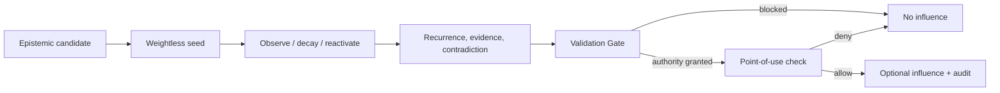

# Shadowseed Pro

Een taalmodel laat zien welk antwoord het gaf. We onderzoeken wat er gebeurt met een mogelijk verband dat buiten dat antwoord bleef: kun je het zonder oordeel bewaren, en kan het later aanleiding geven tot een andere vraag?

A language model shows us the answer it gave. We investigate what happens to a possible relation that did not appear there: can we retain it without passing judgement, and might it lead to a different question later?

[**De filosofie, de aanpak en de oorspronkelijke onderzoeksarchieven | The philosophy, our method and the original research archives**](docs/research/archives/2026-10-27/README.md)

<p align="center">
  <strong>A model-independent, auditable memory and validation engine for language-model applications.</strong>
</p>

<p align="center">
  <a href="https://github.com/E-AI-MODEL/shadowseed-pro/actions/workflows/ci.yml"></a>
  
  
  
  
</p>

<p align="center"><code>trace &gt; 0</code> means remembered. <code>weight = 0</code> means no steering authority.</p>

Shadow Seed Learning (SSL) records **bounded epistemic candidates for investigation**, not hidden truth. A candidate may be a suspected gap, doubt, missing relation or boundary, dependency, unstated assumption, alternative hypothesis, contradiction to investigate, or relevant what-if direction. A new seed starts powerless. It may be remembered, recur, be contradicted, receive independently verified support, and only influence a later answer after the configured Validation Gate and a current point-of-use authorization both allow it.

The product now has an explicit split. `ShadowseedEngine` is the reusable SSL
pipeline and never calls a language model. The local Workbench is the first
complete client of that pipeline: it provides chat, inspection, comparison,
feedback, export, and standalone packaging.

## What we understand now (28 October 2026)

**Open research source archive (28 October):** the [complete 48-call pilot records and original ZIP packages](research/datasets/2026-10-28-q1q2-48/README.md) are now directly readable in GitHub, with immutable source checksums. Public release includes the historical one-off decryption key and treatment-unblinding mappings: the original blind-review allocation is therefore no longer concealed. These records do not claim a Q1/Q2 effect.

**Research navigation (28 October):** Start with the [dated research entry](docs/research/README.md) and the [complete remote-branch register](docs/research/possibility-space/branch-register-2026-10-28.md). The older [possibility-space index](docs/research/possibility-space/README.md) keeps its 25 October context. A candidate's intake label is not a semantic judgement, and weightless persistence is not a demonstrated effect.

Shadowseed is far beyond a concept sketch. The engine, weightless candidate memory, lifecycle, audit trail and separation between observation and authority are implemented. The repository also contains real model runs, multi-turn records and candidate histories. We can now investigate the path from an original response to a recorded candidate and its later opportunities for use. That is substantial progress, even while the larger research question remains open.

### The accumulated record is substantial, and it must stay intact

The current source-preserving reconstruction of the owner-held register contains **220 complete recorded turn rows across 40 trajectories, alongside 1,224 candidate occurrences**. The original serialized turn objects, questions, answers, detector fields and candidate fields are retained. The 40 trajectories are not 40 independent trials.

Literal source-key matching currently gives 368 candidate occurrences with an exact stage match, 96 with a model-label mismatch, and 760 without a matching stage row in that register. All 1,224 occurrences are preserved. The offline reconstruction checked all 220 stage-index keys and confirmed 40 contiguous recorded trajectories; six synthetic regression tests passed. These mismatches and unmatched records are not automatic verdicts about the content, and they do not by themselves prove data loss. They tell us where to return to the original sources and keep attribution explicit. The register is derived material; it does not independently verify the complete contents of all 62 original GitHub Actions archives. See the [28 October source-preserving reconstruction in draft PR #263](https://github.com/E-AI-MODEL/shadowseed-pro/pull/263).

### A pipeline rejection is not a semantic verdict

A source-level audit of the original 27 October dual-model output traced **94 of 94 numbered candidate occurrences** through the parser, normalizer and canonical intake. The historical pipeline accepted 48 and rejected 46 as `not_atomic`. All 46 rejected expressions hit the multi-separator heuristic, and all 46 would pass `is_atomic_seed` if only the final period were changed to a question mark. This is direct evidence of a **form-sensitive intake boundary**. It is not evidence that all 46 candidates were useful; it does mean that `not_atomic` cannot stand in for a semantic assessment. The audit covers 12 dependent model/case trajectories, not 94 independent trials. The `truncated_after_max_seeds` flag appeared in 24 turns, but none had an additional numbered raw line beyond the parsed items, so the flag alone does not establish that content was lost. See the [source-fate audit in draft PR #261](https://github.com/E-AI-MODEL/shadowseed-pro/pull/261).

Draft [PR #261](https://github.com/E-AI-MODEL/shadowseed-pro/pull/261) adds a private, unjudged review queue that preserves each rejected candidate's source, observation ID, host context and answer. The follow-up [draft PR #262](https://github.com/E-AI-MODEL/shadowseed-pro/pull/262) proposes retaining them as unresolved, weightless seeds; its local deterministic replay created 46 of 46 unresolved seeds with weight 0 and no Gate events. That demonstrates a way to **retain a possibility without endorsing it**. It does not establish that the candidates are semantically sound, and the proposed policy is not yet accepted product doctrine.

### We have sharpened the research question

The original question has two connected parts: investigate meaningful possibilities that ordinary generation does not select, and investigate how a formed or reframed possibility might change what can subsequently be conceived or investigated. The object of study is not simply an omitted fact, a missing graph edge, a new relation label, or a longer answer. Those may be examples, but none defines the question. The current theoretical framing is **changes in the effective space of meaningful, investigable possibilities under stated conditions, together with why a probability-oriented generator selects some relations and not others**. The full wording remains in the [foundational thesis](docs/research/possibility-space-thesis.md); the [first-principles reorientation](docs/research/possibility-space/first-principles-reorientation-2026-10-25.md) records how the research framing developed.

### Earlier runs have taught us something concrete about measurement

The first 24-call GPT-5 pilot tested a fixed missing-edge task. That was too narrow to measure the full thesis, so it remains part of the history as an inadequate measurement, not a positive or negative verdict on Shadowseed. The [pilot record](https://github.com/E-AI-MODEL/shadowseed-pro/pull/220) preserves it.

The later live GPT-5 compression pilot completed 30 model calls and three real embedding requests. In the two substantive scenarios, the ordinary answer or compressed summary already retained the relevant direction, and ordinary notes or candidate ablation did not remove the later inquiry. A separate unrelated-lunch case was a single negative carryover check, not a general safety result. The setup did **not** isolate an incremental Shadowseed contribution, and its arms did not have equal total budgets. This is a concrete non-discriminating result from that design, not proof that the mechanism has no effect. It tells us to test cases where the later investigability actually changes and to compare against strong, budget-matched ordinary-model and notes controls. The [full pilot record](docs/research/possibility-space/live-compression-retention-result-2026-10-25.md) retains the case-level account.

### The multi-turn runs now expose real candidate trajectories

A real GPT-5 run used the canonical Engine over two four-turn fictional cases, with 20 model calls and 19 embedding requests. It recorded 24 detector proposals: 11 were accepted by the existing intake and 13 were rejected as `not_atomic`. The first weightless seed remained present over three later turns with decreasing trace and no renewed detection. One important limitation was found in the run itself: the host model could see the full case description while the detector could not, so some apparent gaps may have been caused by unequal context. All seeds remained at weight 0, with no Gate promotion or influence on ordinary answers. See [the recorded multi-turn observations](https://github.com/E-AI-MODEL/shadowseed-pro/blob/research/g0-exploratory-real-model-stage1-20261025/docs/research/possibility-space/g0/real-model-stage1-observations-2026-10-25.md) and [draft PR #250](https://github.com/E-AI-MODEL/shadowseed-pro/pull/250). A subsequent context-parity attempt stopped after an incomplete host response, before a detector call or seed birth, so it did not provide a corrected effect comparison.

A later real-seed run produced **five model-authored T1 research questions** across five isolated conditions (A/B/C/D/E). All five focused on the temporal relation between peaks and controller switching; the seed condition did not clearly differ. The run stopped at T2 with a `ValueError` before any T2 questions were produced. Offline forensic checks reconstructed the five original T1 prompts, but the conditions were not balanced for prompt length and note content. This is actual multi-turn model behaviour and a genuine seed lineage to inspect, not a causal finding of added value. The T2 failure remains unresolved. See [draft PR #251](https://github.com/E-AI-MODEL/shadowseed-pro/pull/251).

### Candidate birth is not the same as downstream effect

The post-alignment Qwen2.5 7B bundle contains 43 recorded live candidate occurrences and 43 candidate-review items. Its exploratory evaluation subset had zero surfaced turns, so it produced no legitimate blinded answer A/B pairs. That is an opportunity-accounting fact, not evidence that Shadowseed has no effect. It makes one of our strongest methodological insights explicit: **a candidate being generated or remembered is not the same as it surfacing, influencing a later answer, or changing what can be investigated next**. These stages must remain separately observable.

The software gives us a real boundary to investigate: `trace` records remembered presence; `weight` represents authority under a configured policy. A candidate can persist without being treated as true or being allowed to steer an answer. The Validation Gate and point-of-use check keep those questions separate. This is an implemented engineering result. Whether the mechanism adds discovery value beyond ordinary notes, deliberate exploration and a strong same-model baseline remains the empirical question.

### Where we are now

We are **not starting over**. We have a substantial record, a functioning system, source-lineage tooling, and specific lessons from experiments that did not discriminate between mechanisms. The next step is to reconstruct and compare the original trajectories, preserve mismatches and negative results, and add new interpretations as traceable layers. Older labels such as `accepted`, `rejected`, `born`, `surfaced` and `promoted` remain part of the record; they do not decide what the underlying text means.

The progress is real. The remaining work is to establish which patterns in the existing material survive source-level examination and which effects can be attributed to Shadowseed under a fair comparison. The detailed research status and historical decisions below remain part of the repository and are not replaced by this summary.

> [!IMPORTANT]
> **Shadowseed Pro is research-ready, not yet production-ready.** Source version 0.12.4 is the current Research Preview release candidate, with an English web interface, model-recognized recurrence and one verified source per promotion in Controlled and Assisted sessions; `v0.12.3` remains the latest published Research Preview until the exact-SHA release workflow succeeds for 0.12.4. `v0.12.1` is not eligible for production-local promotion because of the loopback web API DNS-rebinding finding fixed in 0.12.2. Publication, production readiness and general answer-quality evidence remain separate claims. This candidate does not establish universal missing-information detection, semantic truth, hostile-network safety, hosted/multi-user readiness, or a completed `production-ready/local` claim before the release assurance and the recorded use cycle on the published release are complete.

> [!NOTE]
> Repository states and releases that include [`LICENSE`](LICENSE) are source-available under **PolyForm Noncommercial License 1.0.0**. Noncommercial research, experiment, testing, modification, and distribution are permitted according to those terms. Commercial use requires separate permission. This is not an OSI open-source license. Historical artifacts keep the rights terms distributed with those versions; the new license is not retroactive.

The [manual](docs/manual/README.md) (English and Dutch, also as PDF) explains installation, daily use, the SSL model, development and security. See [the 0.12.4 release notes](docs/workbench/release-0.12.4.md) for the changes since the current download and the remaining local acceptance checks.

## Research horizon: beyond answer omissions (not yet demonstrated)

The **current product** provides auditable, weightless candidate memory with separate Validation Gate and point-of-use authority. Its existing benchmarks study candidate quality, safe influence, and sometimes later answer quality. These outcomes **do not establish** the larger, foundational Shadowseed research question:

> Kunnen we de waarschijnlijkheidsgerichte werking van een taalmodel gebruiken om niet alleen te onderzoeken wat het model weet, niet weet of niet genereert, maar ook welke relaties en mogelijkheden er zouden kunnen zijn buiten de gebruikelijke generatie? En kunnen we onderzoeken hoe nieuwe mogelijkheden ontstaan die de ruimte van wat daarna denkbaar is zelf veranderen?

The wording above is preserved verbatim in the [foundational thesis](docs/research/possibility-space-thesis.md). The open research investigates **both** the probability-oriented model's ordinary selection of possibilities and whether newly formed or reinterpreted possibilities alter what can subsequently be conceived or investigated. A new relation *type*, a missing fact, a better answer, or another generated alternative is not automatically evidence of that phenomenon.

The [first-principles inquiry](docs/research/possibility-space/first-principles-reorientation-2026-10-25.md), [source-to-claim audit](docs/research/possibility-space/source-claim-audit-2026-10-25.md), and [current research index](docs/research/possibility-space/README.md) explain the competing mechanisms, negative controls, and evidence boundaries. The first [24-call GPT-5 fixed-edge pilot](https://github.com/E-AI-MODEL/shadowseed-pro/pull/220) is retained as an **inadequate measurement of the thesis**, not a positive or negative efficacy finding. New research does **not** change shipping behavior or weaken existing authority safeguards.

## Quick start

### 1. Add the SSL engine to an existing model application

```python
from shadowseed import ShadowseedEngine

engine = ShadowseedEngine()
prepared = engine.prepare_turn("Which boundary may be missing here?")

# Your application owns this call, provider, credentials, and conversation history.
try:
    answer = host_model.generate(
        message=prepared.question,
        additional_context=prepared.model_context,
    )
except Exception:
    engine.abort_turn(prepared)
    raise

report = engine.observe_turn(prepared, answer)
print(report["seeds_born_weightless"])
```

`prepare_turn` performs lifecycle, relevance selection, and the recorded
point-of-use check. `observe_turn` performs post-generation detection, intake,
recurrence handling, Gate routing, and audit recording. Call `abort_turn` when
the host model fails or abandons the request; it restores the exact state from
before preparation so the conversation can continue. See the
[engine integration guide](docs/engine/README.md) for the complete contract.

### 2. Test Shadowseed as a normal chat application

For a verified GitHub release, the intended tester path is:

```text
download -> extract/open -> choose model -> create chat -> chat with SSL -> optionally compare one message with SSL off
```

The 0.12 product line adds a packaged local web client on top of the same canonical Python runtime. `shadowseed-web` serves the static web interface and `/api/v1` from one loopback-only Python process and opens the browser automatically; packaged users do not need a Node runtime or a second terminal. `shadowseed-workbench` and frozen bundles open the same web client by default; the legacy Gradio Workbench is only started with `--legacy-gradio`.

The standalone release contract builds Windows, macOS, and Linux archives with an embedded Python runtime. A normal tester does not need Git, system Python, `pip`, benchmark JSON, or an authored baseline answer. The normal standalone is deliberately thin: the deterministic fixture works immediately and local Ollama provides chat plus semantic embeddings when its models are installed. The default `embeddinggemma` semantic model requires Ollama v0.11.10 or later. Hosted OpenAI is available only when the explicit `openai` provider extra is installed; that SDK is not bundled into the thin frozen standalone.

Source and release availability are separate facts. Treat a version as publicly released only after its immutable tag and verified release assets exist.

### 3. Run from source

```bash
git clone https://github.com/E-AI-MODEL/shadowseed-pro.git
cd shadowseed-pro
python -m pip install --upgrade pip
pip install -e ".[test,workbench]"
python -m pytest -q
python -m ruff check .
shadowseed --help
shadowseed-web
# shadowseed-workbench opens the same web client; the legacy Gradio surface is opt-in:
shadowseed-workbench --legacy-gradio
```

Deterministic mechanics demo:

```bash
shadowseed chat --backend fixture --show-shadow
```

Real local model example:

```bash
shadowseed chat --backend ollama --model-id <model> --embedding-backend ollama --embedding-model embeddinggemma
```

For research/evaluation tooling, install the separate research distribution on top of the product checkout:

```bash
pip install --no-deps -e ./research
shadowseed run-dialectic-falsification --help
```

The `shadowseed` CLI stays the entry point, but research commands load their implementation from `shadowseed_research`. A product-only install does not ship benchmark/evaluation implementation.

### 4. Collect privacy-minimized tester data

Each Workbench session can export a full auditable report and a privacy-minimized support bundle. Full reports contain conversation content and should be treated as sensitive. Support bundles omit the direct session identifier, free session title, prompts, generated answers, comparison text, seed text, and free-text tester notes. They retain pseudonymous session identity, model/backend/configuration metadata, environment metadata, and structural counts.

Researchers can combine verified support bundles without importing conversation free text:

```bash
python scripts/aggregate_support_bundles.py \
  tester-a.zip tester-b.zip tester-c.zip \
  --collection-id pilot-2026-08 \
  --output results/pilot-2026-08-support-dataset.json
```

The collector verifies every input ZIP with the normal Workbench export verifier, rejects full reports and duplicate support-session identities, records each source bundle SHA-256, and writes schema `shadowseed-support-dataset-v1`. This creates a reproducible collection artifact. It does **not** turn incidental tester output into efficacy evidence; scientific claims still require a declared protocol, analysis plan, appropriate controls, and review.

See [`docs/workbench/privacy.md`](docs/workbench/privacy.md) and [`docs/workbench/tester-guidelines.md`](docs/workbench/tester-guidelines.md) before collecting or sharing data.

## Evidence upgrade in 0.6.0

Version 0.6.0 does not make the live Gate more permissive. Instead it adds a separate research path for the question the previous architecture work could not answer by itself: **when verified external support grants a candidate authority, does that candidate improve a later answer when it actually surfaces?**

The research design keeps three views separate:

1. the ordinary live `evidence_backed` no-evidence arm remains a negative authority control;
2. the existing `exploratory` evaluation arm remains a recurrence-only non-production counterfactual;
3. the new evidence-backed paired efficacy runner uses baseline-isolated evaluation mechanics while still selecting the shipped `evidence_backed` Gate policy and submitting support only through `ShadowChatSession.submit_evidence`.

A planned evidence event that cannot match its preregistered candidate is recorded as an unmatched opportunity. A Gate block, point-of-use denial, or lack of a later relevant turn is also retained as a result. The runner never changes policy or fabricates evidence merely to create an A/B item.

Canonical preregistration:

```text
src/shadowseed/data/evidence_efficacy_preregistration_v1.json
```

Run and verify a study bundle:

```bash
python -m shadowseed_research.benchmark.evidence_efficacy run \
  --backend <fixture|ollama|hf-transformers|openai> \
  --model-id <model> \
  --suite path/to/evidence-efficacy-suite.json \
  --preregistration src/shadowseed/data/evidence_efficacy_preregistration_v1.json \
  --output-dir results/evidence-efficacy/<run> \
  --embedding-backend <lexical|sentence-transformers|ollama|openai>

python -m shadowseed_research.benchmark.evidence_efficacy verify \
  results/evidence-efficacy/<run>
```

Real-model runs must pin the model and embedding provenance required by the selected backend. Human answer review remains blind and is never filled automatically by the runner. See [`docs/research/evidence-efficacy.md`](docs/research/evidence-efficacy.md) and [`docs/research/capability-scaling.md`](docs/research/capability-scaling.md).

## Research paper and evidence

**Shadowseed: Remembering Without Trusting**  
*A Validation-Gated Memory Architecture for Language Model Systems*

[Paper PDF](paper/shadowseed-paper.pdf) · [LaTeX source](paper/main.tex) · [Bibliography](paper/references.bib) · [Bibliography verification](paper/references-verification.md) · [Paper notes](paper/README.md)

For a visual walkthrough of the product experience, including the model-independent engine, chat, shadow-memory inspection, evidence review, SSL-on/off comparison, exports, and local delivery, see the [product high-level design](docs/architecture/high-level-design.md).

The repository currently identifies software 0.12.4 as the Research Preview release candidate. `v0.12.3` remains the latest published Research Preview until `v0.12.4` is created from an exact verified source SHA; public release availability and production readiness remain separate facts. The manuscript is a reviewed methods/systems snapshot, not a moving release brochure. It carries two explicit historical anchors: the reviewed SSL core at source version 0.5.0, and a separate assurance anchor at software 0.7.1 covering only the persistence, audit, and release-assurance sections. Releases after 0.5.0 extend the product, research instrumentation, persistence, and release-assurance layers around that reviewed core without redefining its authority model. We do not rewrite the compiled paper merely to make a release badge match; a manuscript revision must rebuild `main.tex`, bibliography, and PDF together.

Every entry in the bibliography is recorded in [`paper/references-verification.md`](paper/references-verification.md) with the venue it was checked against and the level of that check. A contract test fails if a citation is added without a verification record.

Canonical research status is documented in [`docs/research/status.md`](docs/research/status.md). Historical benchmark results and immutable evidence bundles remain under `benchmarks/results/**`; ordinary tester exports do not silently become benchmark evidence.

The post-alignment Qwen2.5 7B capability bundle already demonstrates why opportunity accounting matters: it contains real candidate-generation measurements and a pending human candidate-review queue, while the exploratory evaluation subset produced no surfaced turns and therefore no legitimate answer A/B items. That is a sequencing/opportunity result, not evidence that recurrence should be relabeled or that the product Gate should be weakened.

## The idea in plain language

A fluent answer can omit a causal boundary, dependency, stakeholder, alternative explanation, contradiction, or necessary question. SSL lets a detector record a bounded candidate such as:

```text
The answer does not state whether the reported association is causal.
```

That candidate is not accepted as fact. It starts with trace but zero steering weight. The system can keep it available for investigation while separately tracking recurrence, verified external support, contradictions, lifecycle state, Gate decisions, and later point-of-use authorization.

Atomicity is a **normalization target and tested heuristic**. Normalization **does not guarantee semantic atomicity**: a generated candidate can still be compound, vague, redundant, vacuous, or wrong.

## Core invariant

```text
trace  > 0   means the candidate is present in shadow memory
weight = 0   means the candidate has no steering authority
```

| Concept | Meaning | It does not mean |
|---|---|---|
| `trace` | remembered presence, decay, recurrence/reactivation | truth or permission to steer |
| `weight` | bounded steering authority after policy validation | detector confidence |
| recurrence | a renewed eligible observation | external evidence |
| verified support | provenance-bearing external support accepted by policy | universal truth |
| contradiction | an explicit reason to block/reduce authority | deletion from the audit trail |
| promotion | permission to be considered | mandatory use |
| surfacing | contextual selection for a request | bypass of point-of-use checks |



The ordinary product uses `runtime_mode = live` with the `evidence_backed` Gate policy. Recurrence remains observable but cannot grant authority by itself in that policy. Research/evaluation paths can use different explicit policies; policy-dependent validation must not be rewritten as one universal rule.

## Same-message SSL-off comparison

For a live Workbench turn, **Compare this message with SSL off** generates a same-model control from the same pre-turn visible history before the real state-changing turn. The control receives no surfaced seeds and does not enter candidate detection, recurrence, the Validation Gate, or later conversation history.

A textual difference is not automatically an SSL effect. Attribute an observed difference to SSL only when an authorized seed actually surfaced on the live turn; otherwise ordinary generation variance remains a possible explanation.

## What the code enforces

`shadowseed.manager` is the supported high-level orchestration surface. It coordinates canonical concerns rather than reimplementing their authority semantics.

| Enforced property | Canonical implementation | Contract coverage |
|---|---|---|
| New seeds start weightless and authority fields are guarded | [`shadowseed.models`](src/shadowseed/models.py), [`shadowseed.intake`](src/shadowseed/intake.py) | [`test_authority_encapsulation.py`](tests/test_authority_encapsulation.py) |
| Trace and authority remain separate through lifecycle transitions | [`shadowseed.lifecycle`](src/shadowseed/lifecycle.py) | [`test_lifecycle_ttl.py`](tests/test_lifecycle_ttl.py) |
| Gate-controlled authority changes use one typed policy engine | [`shadowseed.gate.runtime_adapter`](src/shadowseed/gate/runtime_adapter.py) | [`test_gate_path_unification.py`](tests/test_gate_path_unification.py) |
| Contradictions are explicit and blocking | [`shadowseed.contradictions`](src/shadowseed/contradictions.py) | [`test_contradiction_lifecycle.py`](tests/test_contradiction_lifecycle.py) |
| Vector search/feedback workflows remain a distinct canonical concern | [`shadowseed.vector_workflows`](src/shadowseed/vector_workflows.py) | [`test_vector_workflows_extraction.py`](tests/test_vector_workflows_extraction.py) |
| Unverified/generated observations are not silently trusted evidence | [`shadowseed.ssot`](src/shadowseed/ssot.py), [`shadowseed.gate`](src/shadowseed/gate/) | [`test_gate_signal_routing.py`](tests/test_gate_signal_routing.py) |
| Influence requires current authority and point-of-use authorization | [`AgentSafetyContract`](src/shadowseed_agent/agent_contract.py) | [`test_point_of_use.py`](tests/test_point_of_use.py) |
| Live history stores the visible answer; evaluation preserves isolated research controls | [`shadowseed.chat`](src/shadowseed/chat.py) | [`test_live_runtime.py`](tests/test_live_runtime.py) |
| Support datasets accept verified minimized bundles only | [`shadowseed.support_collection`](src/shadowseed/support_collection.py) | [`test_workbench_support_collection.py`](tests/test_workbench_support_collection.py) |
| Evidence efficacy uses the canonical evidence-backed trust boundary | [`shadowseed_research.benchmark.evidence_efficacy`](research/src/shadowseed_research/benchmark/evidence_efficacy.py), [`ShadowChatSession.submit_evidence`](src/shadowseed/chat.py) | [`test_evidence_efficacy.py`](research/tests/test_evidence_efficacy.py) |

> **"Non-bypassable" is a public-API property** over supported new authority decisions, not a claim about arbitrary in-process Python mutation, validated state restoration, or explicitly unsafe test hooks.

## Assurance boundaries

- Generated candidate quality is not guaranteed by normalization or by the detector being fluent.
- A researcher/operator marking a source as verified is the external trust anchor; the runner validates signal shape and provenance, not source truth.
- The production-local repository provides a durable tamper-evident authority ledger with protected-anchor integrity checks and audited recovery; it is not an external immutable ledger.
- Point-of-use checks are specific eligibility checks, not universal safety certification.
- A support dataset is structured observational data, not automatic proof of benefit.
- Fixture runs demonstrate mechanics, not real-model quality.
- Platform packaging and checksum provenance do not establish model efficacy.
- Hostile-network authentication, managed multi-user tenancy, and hosted-service operational assurance remain outside the production-local claim; local lifecycle/deletion and recovery controls are covered by the production-local contract.

## Repository map

- `src/shadowseed/` - canonical SSL runtime, chat/application services, export and collection contracts
- `src/shadowseed_agent/` - point-of-use agent authorization and influence audit
- `research/` - installable benchmark/evaluation distribution (`shadowseed_research`) and research regression tests
- `paper/` - manuscript source, bibliography, and compiled reviewed snapshot
- `benchmarks/` - benchmark suites and immutable evidence artifacts
- `experiments/`, `results/` - reproducibility and development research outputs
- `docs/architecture/` - current design and accepted ADRs
- `docs/research/` - evidence status, capability scaling, efficacy protocol, and bounded claim guidance
- `docs/workbench/` - tester, privacy, release, and limitations documentation
- `archive/` - historical provenance, not current authority
- `repository-authority.yaml` - canonical/compatibility/archive ownership map

Historical compatibility surfaces are retained when they protect replay or public API behavior. They should not be mistaken for duplicate canonical implementations.

<details>
<summary><strong>Research and benchmark commands</strong></summary>

Install the separate research component first:

```bash
pip install --no-deps -e ./research
```

The product CLI then routes research commands to `shadowseed_research`:

```bash
shadowseed run-gap-suite
shadowseed run-false-positive-suite
shadowseed run-benefit-suite
shadowseed run-model-benefit-suite --backend fixture
shadowseed run-adversarial-gate-benchmark
shadowseed run-probe-utility-benchmark
shadowseed run-probe-feedback-behavior-suite
shadowseed analyze-results
python -m shadowseed_research.benchmark.capability_scaling --help
python -m shadowseed_research.benchmark.evidence_efficacy --help
```

Optional stacks:

```bash
pip install -e ".[models]"      # Transformers / Sentence Transformers / Torch
pip install -e ".[openai]"      # hosted OpenAI adapter
pip install -e ".[vector]"      # FAISS and Chroma
pip install -e ".[workbench]"   # thin local Gradio Workbench: fixture + Ollama
pip install -e ".[workbench,models]"  # add local Hugging Face/Sentence Transformers
pip install -e ".[workbench,openai]"  # add hosted OpenAI
pip install -e ".[dev]"         # development extras
```

</details>

## Release and reproducibility contract

`Standalone Workbench` builds Windows, macOS, and Linux bundles from one exact source SHA. Frozen bundles must run their packaged self-test, contain the repository license, and emit manifests that include the license hash. `Release Workbench` verifies exact `main` head, source version, standalone manifests, wheel/sdist smoke, exact license inclusion, provenance, and checksums before publication. It rechecks `main` immediately before and after release creation and removes a stale release/tag if the branch moved during publication.

For research reuse, cite `CITATION.cff` and record the exact Git commit, model/backend identity, configuration, protocol, evidence bundle or support-dataset hash, and any externally attested source identities used.

## Rights and status

Repository states and software releases that include `LICENSE` are licensed under **PolyForm Noncommercial License 1.0.0** with the required copyright notice for H. Visser / E-AI-MODEL. Commercial rights are not granted by that license. Historical artifacts keep their original distributed rights terms, and third-party materials retain their own licenses.

Current defensible status: **research-ready, local mass-testable, able to collect structured privacy-minimized tester data, and equipped to run preregistered evidence-backed paired efficacy studies; not production-ready and not proven to improve answers generally.**
