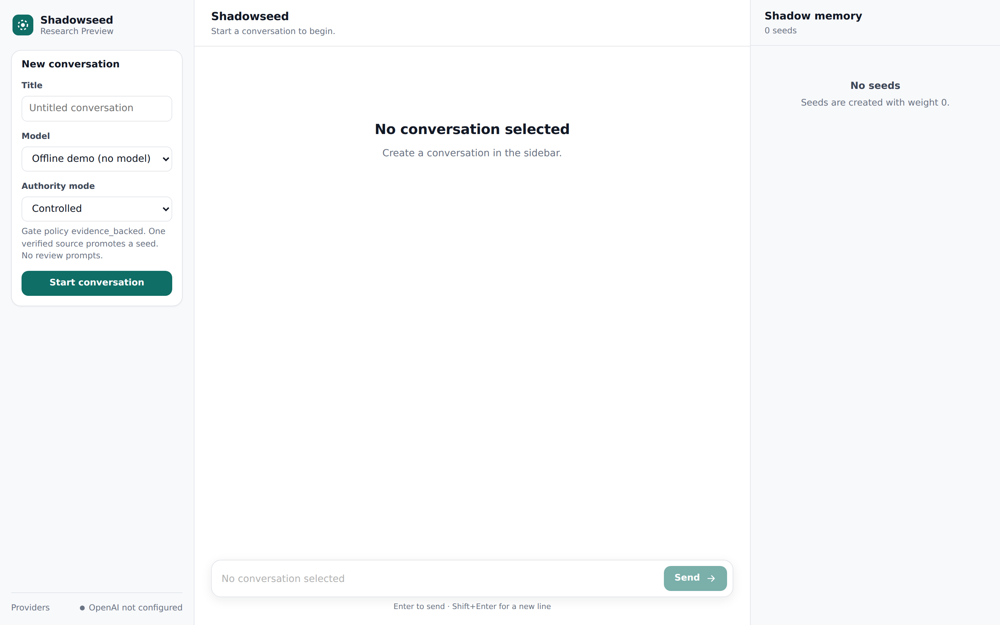
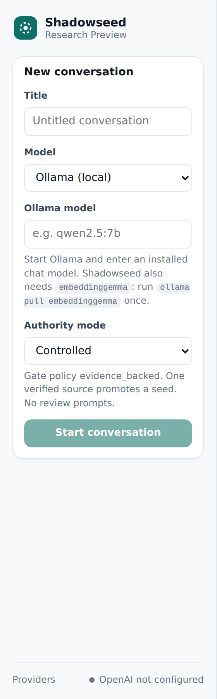
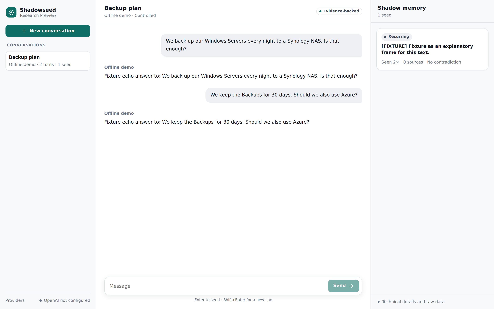
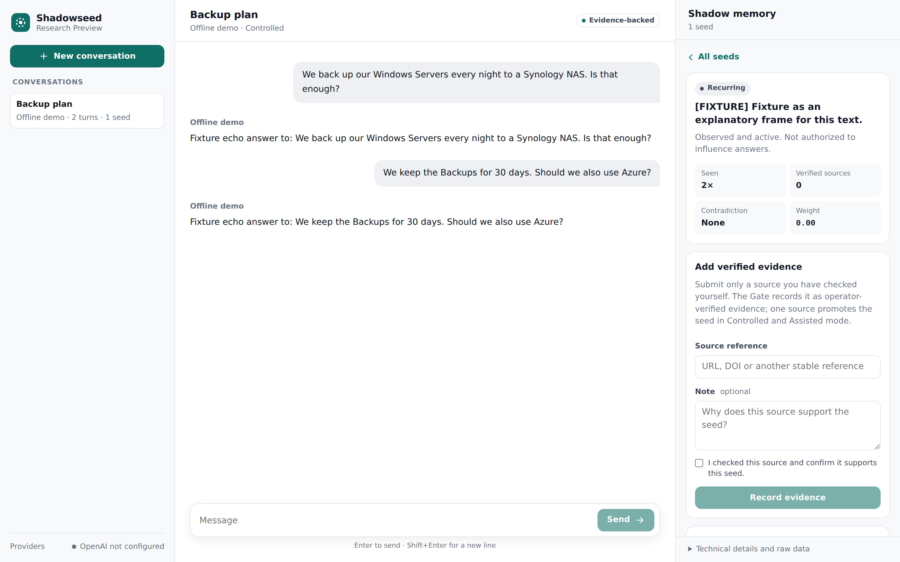
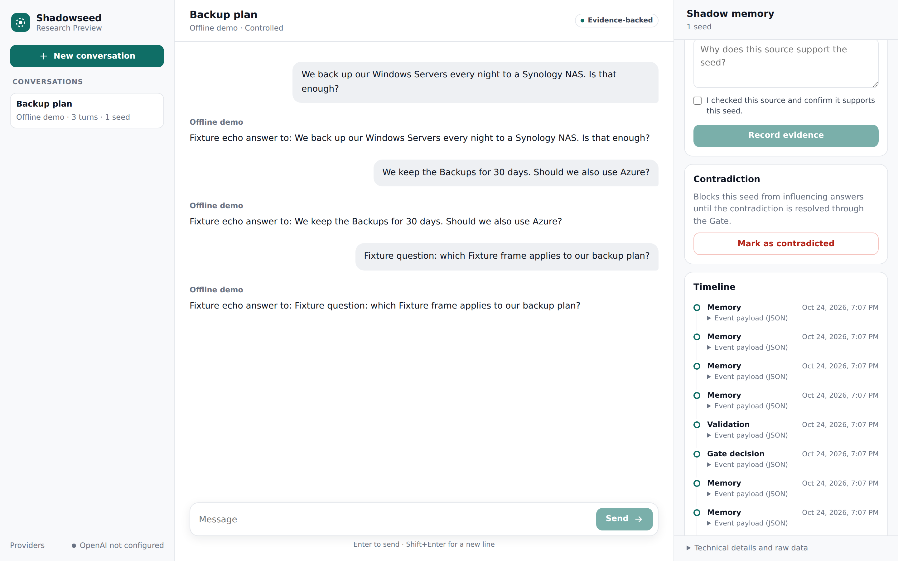
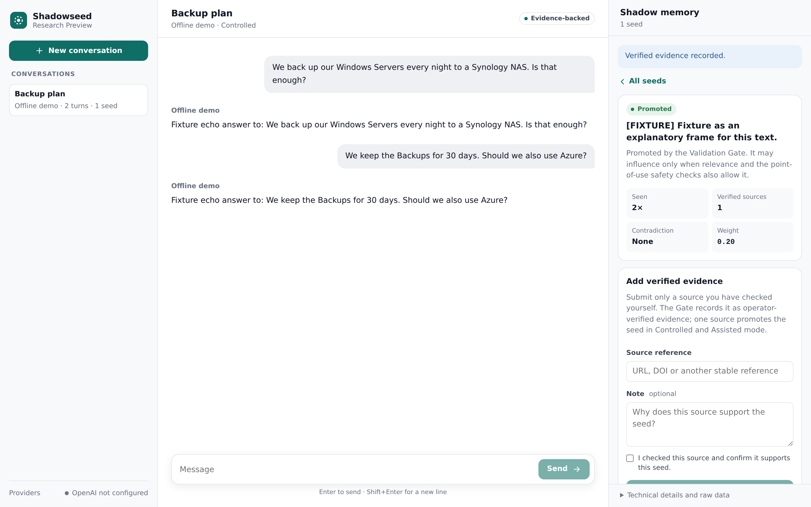

# Shadowseed — Handleiding

**Versie 0.12.4 · Research Preview · oktober 2026**

Deze handleiding beschrijft de downloadbare webapplicatie Shadowseed en het
Python-pakket waaruit die is gebouwd. Ze is geschreven voor vijf groepen
lezers. Iedereen leest deel 1. Ga daarna naar het deel dat bij je rol past.

| Je bent… | Lees |
| --- | --- |
| **Gebruiker** en wilt met Shadowseed chatten | Deel 1 en 2 |
| **Tester** en meldt bevindingen | Deel 1, 2 en 3 |
| **Onderzoeker** naar Shadow Seed Learning | Deel 1, 2 en 4 |
| **Ontwikkelaar** die op Shadowseed bouwt of het aanpast | Deel 1, 4 en 5 |
| **Specialist** in beveiliging, privacy of beheer | Deel 1, 5 en 6 |

De begrippenlijst achterin geeft bij elke term de Engelse naam. De interface
van Shadowseed is Engelstalig; in deze handleiding staan knoppen en velden
daarom in het Engels, **vetgedrukt**, zoals je ze op het scherm ziet. Er is ook
een Engelse editie: `shadowseed-manual-en.md`.

> **Status.** Shadowseed is een *Research Preview*. Het werkt en is getest,
> maar is niet gecertificeerd voor beslissingen in de zorg, financiën, recht,
> werk, onderwijs of andere gebieden met grote gevolgen. Hoofdstuk 14 noemt de
> beperkingen.

## Inhoud

- Deel 1 — Aan de slag
  1. Wat Shadowseed is
  2. Systeemeisen
  3. Shadowseed installeren
  4. Een lokaal model instellen met Ollama
  5. Je eerste gesprek
- Deel 2 — Shadowseed gebruiken
  6. Het scherm
  7. Seeds en hun status
  8. Zeggenschapsmodi
  9. Geverifieerd bewijs toevoegen
  10. Tegenspraak
  11. Wanneer een seed een antwoord beïnvloedt
  12. OpenAI gebruiken
  13. Je gegevens en privacy
  14. Beperkingen
  15. Problemen oplossen
- Deel 3 — Testen
  16. Shadowseed testen
- Deel 4 — Onderzoek
  17. Het model van Shadow Seed Learning
  18. Aantonen dat SSL effect had
  19. Studies en bewijs
- Deel 5 — Ontwikkeling
  20. Werken vanuit de broncode
  21. Architectuur
  22. Overzicht van de opdrachtregel
  23. Overzicht van de web-API
  24. Builds en releases
- Deel 6 — Beveiliging en beheer
  25. Beveiligingsmodel
  26. Shadowseed betrouwbaar draaien
  27. Instellingen
- Bijlagen
  - A. Begrippenlijst (Nederlands–Engels)
  - B. Veelgestelde vragen
  - C. Over dit document

---

# Deel 1 — Aan de slag

## 1. Wat Shadowseed is

Shadowseed is een chatapplicatie met een extra geheugenlaag: **Shadow Seed
Learning (SSL)**. Je praat zoals gewoonlijk met een taalmodel. Naast het
gesprek kijkt Shadowseed bij elk antwoord welke punten nog open staan: een
aanname die niet is gecontroleerd, een getal dat ontbreekt, een situatie die
niet aan bod kwam. Zo'n punt slaat het op als **seed**.

Een seed begint zonder enige invloed. Invloed krijgt een seed alleen via de
**Validation Gate** (de validatiepoort), en in de standaardmodus wil die Gate
een bron die *jij* hebt gecontroleerd. Pas als een seed de Gate is gepasseerd,
mag Shadowseed hem in een later antwoord terugbrengen — en alleen als hij op
dat moment relevant is voor de vraag.

Drie ideeën dragen het hele ontwerp:

- **Breed waarnemen, zuinig zeggenschap geven, gericht terughalen.** Veel seeds
  worden opgemerkt; weinig mogen sturen; alleen de relevante worden gebruikt.
- **Zeggenschap komt uit bewijs, niet uit herhaling.** Een seed die vaak
  terugkomt is interessant, maar wordt daardoor nog niet waar.
- **Elke beslissing is zichtbaar.** Elke seed heeft een tijdlijn, en elke
  beslissing van de Gate wordt vastgelegd.

Shadowseed traint het model niet opnieuw. Het model blijft hetzelfde; het
geheugen eromheen groeit. Twee installaties met hetzelfde model kunnen daardoor
een verschillend geheugen opbouwen.

Wat Shadowseed **niet** belooft:

- dat seeds waar zijn;
- dat antwoorden beter worden (daar loopt nog onderzoek naar);
- dat een bron die jij als gecontroleerd markeert ook klopt — dat blijft jouw
  verantwoordelijkheid.

## 2. Systeemeisen

| Onderdeel | Eis |
| --- | --- |
| Besturingssysteem | Windows 10/11 (64-bit), macOS op Apple silicon (M1 of nieuwer), Linux x86_64 |
| Schijfruimte | Ongeveer 200 MB voor Shadowseed, plus ruimte voor modellen (een 7B-model is ongeveer 4,7 GB) |
| Werkgeheugen | Minimaal 8 GB voor een 7B-model; 16 GB aanbevolen |
| Ollama | Versie 0.11.10 of nieuwer, voor echte gesprekken |
| Browser | Een recente Chrome, Edge, Firefox of Safari |
| Netwerk | Niet nodig voor lokaal gebruik, behalve om het programma en de modellen te downloaden |

**Snelheid.** Op een computer zonder geschikte grafische kaart heeft een
7B-model ongeveer twee tot drie minuten per beurt nodig. Een GPU of een kleiner
model maakt dat veel korter. De offline demo heeft geen model nodig en
reageert direct.

## 3. Shadowseed installeren

### 3.1 Downloaden

Ga naar de releasepagina van het project op GitHub en download het archief
voor jouw systeem:

| Systeem | Bestand |
| --- | --- |
| Windows | `shadowseed-web-0.12.4-windows-amd64.zip` |
| macOS (Apple silicon) | `shadowseed-web-0.12.4-darwin-arm64.zip` |
| Linux | `shadowseed-web-0.12.4-linux-x86_64.tar.gz` |

Download ook `SHA256SUMS` als je het bestand wilt controleren.

### 3.2 De download controleren (aanbevolen)

De controlesom bewijst dat je precies het gepubliceerde bestand hebt.

- **Windows (PowerShell):** `Get-FileHash .\shadowseed-web-0.12.4-windows-amd64.zip`
- **macOS:** `shasum -a 256 shadowseed-web-0.12.4-darwin-arm64.zip`
- **Linux:** `sha256sum shadowseed-web-0.12.4-linux-x86_64.tar.gz`

Vergelijk de uitkomst met de bijbehorende regel in `SHA256SUMS`. Ze moeten
exact gelijk zijn.

### 3.3 Uitpakken en starten

**Windows.** Klik met de rechtermuisknop op het ZIP-bestand en kies *Alles
uitpakken*. Open de uitgepakte map, dan de map `Shadowseed`, en start
`Shadowseed.exe`. Windows kan een SmartScreen-waarschuwing tonen, omdat het
programma niet met een Microsoft-certificaat is ondertekend. Kies *Meer
informatie* en dan *Toch uitvoeren*.

**macOS.** Dubbelklik op het ZIP-bestand om het uit te pakken. De app is
ondertekend voor integriteit, maar niet door Apple genotariseerd. Daarom
blokkeert macOS de eerste start van een gedownloade kopie. Klik met de
rechtermuisknop op `Shadowseed` en kies *Open*, en bevestig. Weigert macOS het
dan nog, voer dan één keer in Terminal uit:
`xattr -dr com.apple.quarantine /pad/naar/Shadowseed.app`.

**Linux.** Pak uit met `tar -xzf shadowseed-web-0.12.4-linux-x86_64.tar.gz` en
start het programma `Shadowseed` in de uitgepakte map.

Na het starten opent Shadowseed je webbrowser op een adres als
`http://127.0.0.1:8765/`. Dat adres bestaat alleen op je eigen computer;
niemand anders kan erbij. Is poort 8765 bezet, dan kiest Shadowseed zelf een
andere vrije poort en opent die.

Laat het venster of de terminal van Shadowseed open terwijl je werkt. Als je
het sluit, stopt het programma. Je gesprekken blijven bewaard.

### 3.4 Waar je gegevens staan

Shadowseed bewaart alles in één map in je persoonlijke map:

| Systeem | Map |
| --- | --- |
| Windows | `C:\Users\<naam>\.shadowseed` |
| macOS | `/Users/<naam>/.shadowseed` |
| Linux | `/home/<naam>/.shadowseed` |

Daarnaast staat een map `.shadowseed-integrity` met de beschermde sleutel en
het ankerpunt van het auditlogboek. Kopieer, verplaats of verwijder deze mappen
niet met de hand; gebruik de opdrachten uit hoofdstuk 13: `workspace delete`
verwijdert beide mappen, en een back-up zet je alleen terug met
`workspace restore`. Hoofdstuk 13 legt ook uit wat er wordt opgeslagen.

## 4. Een lokaal model instellen met Ollama

De offline demo laat zien hoe Shadowseed werkt, zonder model. Voor echte
gesprekken gebruikt Shadowseed **Ollama**, dat taalmodellen op je eigen
computer draait.

1. Installeer Ollama via ollama.com (versie 0.11.10 of nieuwer) en start het.
2. Download een chatmodel, bijvoorbeeld in een terminal:
   `ollama pull qwen2.5:7b-instruct`
3. Download het embeddingmodel dat Shadowseed nodig heeft om teksten te
   vergelijken: `ollama pull embeddinggemma`
4. Controleer of beide er zijn: `ollama list`

Elk chatmodel dat Ollama kan draaien werkt. Grotere modellen geven betere
antwoorden en vinden meer bruikbare seeds, maar vragen meer geheugen en tijd.

**Welk model?** In onze metingen vindt een 7B-model op een gewone computer in
ongeveer één op de acht beurten een seed, en ongeveer een kwart van die seeds
is bruikbaar. Grote gehoste modellen vinden veel meer bruikbare seeds (51 van
de 60 in een steekproef). Wil je vooral het mechanisme zien, dan volstaat de
offline demo of een klein model. Wil je bruikbare seeds, gebruik dan het
grootste model dat je computer aankan.

## 5. Je eerste gesprek

### 5.1 Begin met de offline demo

De offline demo gebruikt geen model. De antwoorden zijn eenvoudige echo's en
de seeds zijn gemarkeerd met `[FIXTURE]`. De demo is bedoeld om de bediening
te laten zien, niet om goede antwoorden te geven.

1. Geef in het linkerpaneel onder **New conversation** het gesprek een titel.
2. Laat **Model** op *Offline demo (no model)* staan.
3. Laat **Authority mode** op *Controlled* staan.
4. Klik op **Start conversation**.
5. Typ een bericht en druk op **Enter**.



*Afbeelding 1 — Het startscherm. Links: nieuw gesprek. Midden: de chat.
Rechts: het schaduwgeheugen (Shadow memory).*

### 5.2 Een echt gesprek met Ollama

1. Klik op **New conversation**.
2. Kies bij **Model** voor *Ollama (local)*.
3. Vul bij **Ollama model** de exacte naam van een geïnstalleerd model in,
   bijvoorbeeld `qwen2.5:7b-instruct`. Gebruik de naam precies zoals
   `ollama list` hem toont.
4. Kies een zeggenschapsmodus (hoofdstuk 8) en klik op **Start conversation**.



*Afbeelding 2 — Een gesprek aanmaken met een lokaal Ollama-model.*

Draait Ollama niet, of ontbreekt `embeddinggemma`, dan laat Shadowseed zien wat
je moet doen en maakt het gesprek niet aan. Los het op en probeer het opnieuw.

Stel een echte vraag en voer het gesprek een tijdje. Seeds verschijnen in het
rechterpaneel zodra Shadowseed open punten vindt. Hoe langer het gesprek, hoe
groter de kans dat een punt terugkomt.

---

# Deel 2 — Shadowseed gebruiken

## 6. Het scherm



*Afbeelding 3 — Een gesprek met één seed in het schaduwgeheugen.*

Het scherm heeft drie panelen.

**Links — Conversations (gesprekken).** Je gesprekken, nieuwste bovenaan, met
het model, het aantal beurten en het aantal seeds. **New conversation** opent
het formulier. Onderaan laat **Providers** zien of OpenAI beschikbaar is
(hoofdstuk 12).

**Midden — de chat.** De kop toont de titel, het model, de zeggenschapsmodus
en een label met het Gate-beleid (bijvoorbeeld *Evidence-backed*). Typ onderaan
en druk op **Enter** om te versturen; **Shift+Enter** begint een nieuwe regel.
Terwijl het model werkt, zie je *Waiting for response…*.

**Rechts — Shadow memory (schaduwgeheugen).** Alle seeds van dit gesprek. Elke
kaart toont de status, de tekst, hoe vaak de seed is gezien, hoeveel
geverifieerde bronnen hem steunen, hoe vaak hij is gebruikt en of er
tegenspraak openstaat. Klik op een kaart om de seed te openen. Onderaan toont
**Technical details and raw data** het Gate-beleid, het zeggenschapsprofiel,
de gedragsvingerafdruk (behavior digest) en alle sessiegegevens als JSON.

Op een telefoon of in een smal venster klappen de zijpanelen in. Gebruik de
menuknop voor je gesprekken en de knop **Shadow** voor het schaduwgeheugen.

## 7. Seeds en hun status

Een seed is een korte, herleidbare notitie over een punt dat mogelijk open
staat. Het is een *hypothese*, geen feit en geen opdracht.

Elke seed heeft een status. De status vertelt wat de seed mag.

| Status | Betekenis | Kan hij een antwoord beïnvloeden? |
| --- | --- | --- |
| **Found** (gevonden) | Eén keer opgemerkt. | Nee |
| **Recurring** (terugkerend) | In een latere beurt opnieuw opgemerkt. | Nee |
| **Supported** (gesteund) | Heeft minstens één geverifieerde bron, maar nog geen gewicht van de Gate. | Nee |
| **Validated** (gevalideerd) | Heeft gewicht van de Gate, maar is (nog of niet meer) niet gepromoveerd. | Nee |
| **Promoted** (gepromoveerd) | Door de Gate. Mag worden gebruikt als hij relevant is. | Ja, als hij relevant is |
| **Used** (gebruikt) | Gepromoveerd en minstens één keer echt in een antwoord gebruikt. | Ja, als hij relevant is |
| **Blocked** (geblokkeerd) | Er staat tegenspraak open. | Nee |
| **Dormant** (slapend) | Een tijd niet gezien; het spoor is vervaagd. Kan wakker worden als het onderwerp terugkomt. | Nee |
| **Expired** (verlopen) | Helemaal vervaagd. Blijft bewaard voor de verantwoording. | Nee |

Een *Recurring* seed in de modus **Assisted** kan het label *Action required*
krijgen: hij blijft terugkomen zonder bron. Shadowseed vraagt je dan om ernaar
te kijken, in plaats van zelf invloed toe te kennen.

### Een seed openen



*Afbeelding 4 — Een geopende seed met zijn tellers en het bewijsformulier.*

Het detailscherm toont:

- **Seen** — in hoeveel beurten de seed is waargenomen;
- **Verified sources** — hoeveel verschillende gecontroleerde bronnen hem steunen;
- **Contradiction** — of er tegenspraak openstaat;
- **Weight** — zijn stuurkracht, tussen 0 en 1. Nieuwe seeds beginnen op 0;
- **Used in answers** — hoe vaak hij een antwoord heeft beïnvloed;
- **Trace** — een vervagende maat voor recente aanwezigheid;
- formulieren voor bewijs en tegenspraak, de **Timeline** (tijdlijn) en
  **Raw data** (ruwe gegevens).



*Afbeelding 5 — De tijdlijn. Elke geheugengebeurtenis, validatie en
Gate-beslissing staat erin met tijdstip. Open een gebeurtenis voor het
volledige record.*

### Hoe seeds terugkomen

Als een nieuwe notitie misschien hetzelfde open punt is als een eerdere seed,
stelt Shadowseed het model één korte vraag: is dit dezelfde open vraag, of
alleen hetzelfde onderwerp? Alleen "dezelfde vraag" telt als terugkeer. Kan het
model niet antwoorden, dan valt Shadowseed terug op tekstgelijkenis met een
voorzichtige drempel. Terugkeer wordt vastgelegd, maar geeft in de modi
Controlled en Assisted nooit zelf zeggenschap.

## 8. Zeggenschapsmodi

Je kiest de zeggenschapsmodus (**Authority mode**) bij het aanmaken van een
gesprek. Hij bepaalt hoe een seed invloed kan krijgen.

| Modus | Gate-beleid | Hoe een seed zeggenschap krijgt | Gebruik hem voor |
| --- | --- | --- | --- |
| **Controlled** (standaard) | Evidence-backed | Alleen via een bron die jij hebt gecontroleerd. Eén geverifieerde bron promoveert de seed. | Normaal gebruik |
| **Assisted** | Evidence-backed | Als Controlled; daarnaast vraagt Shadowseed je aandacht als een seed blijft terugkomen zonder bron. | Als je een seintje wilt |
| **Autonomous** | Exploratory | Terugkeer telt als steun; een externe bron is niet nodig. | Alleen onderzoek |

In de technische details heet Controlled het zeggenschapsprofiel `strict`.

In de modus Autonomous kent het systeem zeggenschap toe zonder jou. Gebruik
hem om het mechanisme te bestuderen, niet voor antwoorden waarop je wilt
vertrouwen.

## 9. Geverifieerd bewijs toevoegen

In de modi Controlled en Assisted wordt een seed alleen *Promoted* via een bron
die je zelf hebt gecontroleerd.

1. Open de seed.
2. Vul onder **Add verified evidence** een **Source reference** in: een URL,
   een DOI of een andere vaste verwijzing.
3. Voeg eventueel een **Note** toe waarin je uitlegt waarom de bron de seed
   steunt.
4. Vink aan: **I checked this source and confirm it supports this seed.**
5. Klik op **Record evidence**.



*Afbeelding 6 — Na één geverifieerde bron is de seed Promoted, met gewicht 0,20.*

Regels die de Gate beschermen:

- **Vink alleen aan wat je hebt gelezen.** Je bevestiging wordt in het
  auditlogboek vastgelegd als jouw verklaring.
- **Eén bron telt één keer.** Dezelfde verwijzing nogmaals invoeren geeft geen
  extra zeggenschap, ook niet via een andere route.
- **Uitvoer van het model is geen bewijs.** Verwijs niet naar een antwoord of
  samenvatting van het model.
- **Terugkeer is geen bewijs.** Ook een seed die vaak terugkwam heeft een bron
  nodig.

## 10. Tegenspraak

Merk je dat een seed onjuist, misleidend of verouderd is:

1. Open de seed.
2. Klik onder **Contradiction** op **Mark as contradicted**.

De seed is nu **Blocked** en kan geen enkel antwoord meer beïnvloeden.

Om de blokkade op te heffen vul je een **Basis for resolution** in — waarom de
tegenspraak niet meer geldt — en klik je op **Resolve contradiction**. Dat heft
alleen de blokkade op. De seed krijgt zijn zeggenschap **niet** vanzelf terug;
hij moet opnieuw door de Gate, met een nieuwe geverifieerde bron.

## 11. Wanneer een seed een antwoord beïnvloedt

Een seed beïnvloedt een antwoord alleen als op het moment van je vraag aan
alles hiervan is voldaan:

1. hij is **Promoted**, met een gewicht boven nul;
2. die promotie rust op een actuele Gate-beslissing;
3. er staat geen tegenspraak open;
4. hij is **relevant** voor je huidige vraag;
5. de **controle op het moment van gebruik** (point of use) laat hem toe voor
   deze beurt.

*Promoted* betekent dus niet *gebruikt*. Een gepromoveerde seed over de
bewaartermijn van back-ups blijft stil als je over iets anders vraagt. Dat is
de bedoeling.

Wordt een seed gebruikt, dan wordt zijn status **Used** en loopt de teller
**Used in answers** op. De seed bereikt het model als begrensde context die als
onbetrouwbaar is gemarkeerd; het model krijgt niet te horen dat het een feit
is.

Nog één regel: als een seed in een antwoord is gebruikt, worden nieuwe seeds
uit datzelfde antwoord voor die beurt opzijgezet. Zo leert Shadowseed niet van
zijn eigen invloed.

## 12. OpenAI gebruiken

De downloadbare applicatie werkt alleen met lokale modellen. OpenAI-modellen
zijn beschikbaar als Shadowseed als Python-pakket is geïnstalleerd met de extra
`openai` (hoofdstuk 20). Dan geldt:

- je vult een sleutel in onder **Providers → Temporary API key**. De sleutel
  blijft alleen in het geheugen; hij wordt niet opgeslagen en verdwijnt als
  Shadowseed stopt;
- bij het aanmaken van een OpenAI-gesprek moet je ermee instemmen dat prompts,
  schaduwcontext en embeddings naar OpenAI gaan;
- die instemming bevestig je opnieuw bij elk bericht dat je verstuurt.

## 13. Je gegevens en privacy

**Wat er wordt opgeslagen.** De map `.shadowseed` in je persoonlijke map bevat
een lokale database met je gesprekken, de antwoorden van het model, seeds,
Gate-beslissingen, bewijsverwijzingen en notities, en het auditlogboek. De
beschermde integriteitssleutel daarvan staat in de naastgelegen map
`.shadowseed-integrity`. Er gaat niets naar buiten, tenzij je OpenAI gebruikt.

**Wat je niet intypt.** Plak geen wachtwoorden, API-sleutels, toegangstokens
of andere geheimen in gesprekken, bewijsverwijzingen of notities. Gebruik
verzonnen of geanonimiseerd materiaal als echte persoonsgegevens niet nodig zijn.

**Back-ups en verwijderen.** De webapplicatie heeft nog geen exportknop. Met
het Python-pakket geïnstalleerd gebruik je:

- `shadowseed workspace info` — laat zien waar de gegevens staan en hoeveel het is;
- `shadowseed workspace backup --output <bestand>` — maakt een consistente kopie
  van de database. Geef altijd een bestand **buiten** `.shadowseed` op: zonder
  `--output` komt de kopie in `.shadowseed/exports`, en die verdwijnt als je de
  werkmap verwijdert;
- `shadowseed workspace restore <bestand>` — zet een kopie terug;
- `shadowseed workspace delete --yes` — verwijdert de hele werkmap;
- `shadowseed export-workbench-report <sessie>` — exporteert één gesprek als
  geverifieerd rapport (met de volledige inhoud);
- `shadowseed export-support-bundle <sessie>` — exporteert een
  privacyvriendelijke supportbundel (zonder gespreks- of seedtekst).

De `<sessie>`-id staat onder **Technical details and raw data** → **Session**.

Een back-up bevat dezelfde inhoud als het origineel en moet je net zo goed
beschermen. Het verwijderen van de werkmap wist alles in `.shadowseed`, ook
`.shadowseed/exports`; kopieën die je elders hebt bewaard, blijven bestaan.

## 14. Beperkingen

- **Weinig seeds met kleine lokale modellen.** Met een 7B-model verschijnt in
  ongeveer één op de acht beurten een seed, en ongeveer een kwart van de seeds
  is bruikbaar.
- **Snelheid op de CPU.** Twee tot drie minuten per beurt met een 7B-model op
  een computer zonder geschikte GPU.
- **Geen bewijs voor betere antwoorden.** Of SSL antwoorden verbetert, wordt nog
  onderzocht. Er is een pilotstudie; een volledige uitkomst nog niet.
- **Seeds kunnen onjuist zijn.** Een seed is een hypothese. Een gepromoveerde
  seed wordt door jouw bron gesteund, niet bewezen.
- **Eén gebruiker, één computer.** Shadowseed is geen dienst voor meerdere
  gebruikers of via het netwerk.
- **Niet ondertekend door Apple of Microsoft.** Je systeem waarschuwt bij de
  eerste start.
- **Interface in het Engels.** De applicatie zelf is voorlopig alleen Engelstalig.
- **Geen vergelijkknop.** De webapplicatie biedt de vergelijking "dezelfde vraag
  zonder SSL" nog niet aan; die is beschikbaar via de web-API (hoofdstuk 18).

## 15. Problemen oplossen

| Probleem | Waarschijnlijke oorzaak | Wat te doen |
| --- | --- | --- |
| De browser opent niet | Geblokkeerd door het systeem of geen standaardbrowser | Open zelf het adres dat in het venster van Shadowseed staat |
| macOS: "kan niet worden geopend" | Quarantaine op een gedownloade app | Rechtermuisknop → Open, of de `xattr`-opdracht uit 3.3 |
| Windows: SmartScreen-waarschuwing | Programma niet ondertekend | Meer informatie → Toch uitvoeren |
| "Ollama not reachable" | Ollama draait niet | Start Ollama en probeer opnieuw |
| Melding over `embeddinggemma` | Embeddingmodel ontbreekt of Ollama is te oud | `ollama pull embeddinggemma`; werk Ollama bij naar 0.11.10 of nieuwer |
| "Model not found" | Modelnaam wijkt af van de geïnstalleerde naam | Gebruik de exacte naam uit `ollama list` |
| Een beurt duurt minuten | Het model draait op de CPU | Normaal voor 7B op de CPU; gebruik een kleiner model of een GPU |
| Er verschijnen geen seeds | Kleine modellen vinden vaak niets | Ga door met het gesprek; probeer een groter model |
| Label *Provider needed* | Het model van dit gesprek is niet beschikbaar | Start Ollama of stel OpenAI in |

### De doctor

Het Python-pakket bevat een diagnosehulpmiddel:

```bash
shadowseed doctor
```

Het controleert Python, de werkmap, de database, het auditlogboek, de
rechten, de schijfruimte, Ollama, de embedding-instelling en de optionele
providers, en vertelt hoe je oplost wat het vindt. Een typische uitvoer:

```text
python                   OK    3.11.15
workspace                OK    /home/jij/.shadowseed
production_integrity     OK    verified ledger head sequence 7
ollama                   WARN  not detected at http://127.0.0.1:11434
                               Start `ollama serve`, pull a model, and rerun `shadowseed doctor`.
Workbench can start.
```

Wil je de doctor gebruiken bij de gedownloade applicatie, installeer dan het
Python-pakket uit dezelfde release (zie 20.1) en voer `shadowseed doctor` uit;
die controleert dezelfde map `.shadowseed`.

---

# Deel 3 — Testen

## 16. Shadowseed testen

### 16.1 Waar je op let

- Kun je de applicatie downloaden, starten en gebruiken zonder andere software?
- Is duidelijk welk model actief is en welke zeggenschapsmodus geldt?
- Voelt het als een gewone chat voordat je naar de seeds kijkt?
- Zijn de statussen en uitleg bij seeds begrijpelijk?
- Is duidelijk dat jij het bewijs moet controleren, en dat terugkeer geen bewijs is?
- Helpen de foutmeldingen als Ollama of een model ontbreekt?
- Kun je een gesprek sluiten en heropenen zonder iets kwijt te raken?

### 16.2 Hoe je test

1. Begin met de offline demo. Die bewijst de werking, niet de kwaliteit.
2. Gebruik daarna Ollama met een echt model en langere gesprekken (acht beurten
   of meer), want seeds en terugkeer hebben tijd nodig.
3. Noteer het model, de zeggenschapsmodus en wat je deed.

### 16.3 Een probleem melden

Vermeld wat je probeerde, het model en de instellingen, de kortste reeks
stappen die het probleem laat zien, wat je verwachtte en wat er gebeurde, en of
er in die beurt een seed is gebruikt. Zet er geen persoonsgegevens of geheimen in.

Gedrag waarbij iemand het gewicht of de promotie van een seed rechtstreeks kan
veranderen, buiten de Gate om, is een ernstig gebrek. Meld dat met voorrang.

### 16.4 Supportbundels

Met het Python-pakket maakt `shadowseed export-support-bundle <sessie>` een
privacyvriendelijke supportbundel. Die bewaart de structuur en tellingen, maar
laat gespreks- en seedtekst weg. Studiecoördinatoren voegen bundels samen met
`scripts/aggregate_support_bundles.py`. Bewerk een bundel niet met de hand; de
integriteitscontrole faalt dan.

---

# Deel 4 — Onderzoek

## 17. Het model van Shadow Seed Learning

### 17.1 Levenscyclus

**Waarnemen → Seed → Terugkeer / bewijs verzamelen → Valideren → Promoveren →
Relevantiecontrole → Invloed op het moment van gebruik.** Elke stap staat los
van de andere, en alleen de Gate verandert zeggenschap.

- **Detectie** leest de vraag, het conceptantwoord en een begrensd venster van
  eerdere beurten, en stelt tot vijf atomaire kandidaat-gaten voor. De prompt
  is `detector_current_pair` v0.6.
- **Toelating (intake)** laat een kandidaat toe als gewichtloze seed als het één
  vraag is, of één Engelse bewering die geen kale opsomming van categorieën is.
- **Terugkeer** wordt herkend door het sessiemodel (ADR-012), met
  embeddinggelijkenis als ondergrens (0,3) en als terugvaloptie.
- **Spoor (trace)** legt aanwezigheid vast en neemt af met een halfwaardetijd;
  seeds worden slapend en later verlopen. Een slapende seed kan weer actief
  worden als zijn onderwerp terugkomt.
- **Gewicht (weight)** is stuurkracht. Nieuwe seeds beginnen op 0. Alleen de
  Gate verhoogt het.

### 17.2 Gate-beleid

| Beleid | Accepteert |
| --- | --- |
| `evidence_backed` | Alleen geverifieerde externe steun. In live-sessies met Controlled en Assisted promoveert één bron (drempel 0,2, ADR-011). |
| `exploratory` | Voldoende terugkeer *of* geverifieerde externe steun. |
| `legacy_evidence_required` | Historische drempels voor terugkeer, spoor en bewijs; bewaard voor compatibiliteit. |

Geverifieerde steun heeft een niet-lege `source_ref` nodig; die verwijzing is
de identiteit van het bewijs, en dezelfde verwijzing telt nooit twee keer.
Tegenspraak wordt als expliciet record vastgelegd, met id, reden, status en
oplossingsgrond; een seed met openstaande tegenspraak is geblokkeerd. Oplossen
heft de blokkade op, maar herstelt het gewicht niet.

### 17.3 Moment van gebruik

Voordat een seed de generatie mag beïnvloeden, controleert
`AgentSafetyContract.decide_and_record` een positief gewicht, de status
promoted, het ontbreken van blokkerende tegenspraak, en een geldige
Gate-gebeurtenis voor de huidige zeggenschapsversie van de seed. Toegestane en
geweigerde beslissingen worden allebei vastgelegd, en elke toegestane beslissing
is gekoppeld aan de Gate-gebeurtenis die haar mogelijk maakte. Bij het
terugspelen kan een verouderde toestemming worden opgespoord.

### 17.4 Twee soorten geheugen

Onder `evidence_backed` is terugkeer een waarneming: een *spoor*. Onder
`exploratory` kan terugkeer na drie keer een steunsignaal worden. De standaard
in het product is `evidence_backed`.

## 18. Aantonen dat SSL effect had

Een andere formulering tussen twee antwoorden bewijst geen invloed van SSL,
want twee generaties verschillen toch al. Schrijf een effect alleen aan SSL toe
als:

1. de seed was gepromoveerd;
2. hij voor die beurt als relevant was geselecteerd;
3. de beslissing op het moment van gebruik hem toeliet;
4. hij daadwerkelijk is ingebracht, zoals vastgelegd in het beurtrapport en de
   tijdlijn van de seed.

Voor een gepaarde vergelijking kun je een beurt via de web-API (hoofdstuk 23)
versturen met `compare_without_ssl: true`. De controle gebruikt hetzelfde model,
dezelfde zichtbare geschiedenis en hetzelfde bericht, krijgt geen
seedcontext en verandert niets aan de opgeslagen toestand. De webapplicatie
bewaart de vergelijking onder **Technical details → Last turn comparison**;
een knop ervoor is er nog niet.

## 19. Studies en bewijs

De repository bevat vooraf vastgelegde studieopzetten en hun uitkomsten:

- **Seedkalibratie** (`docs/research/seed-calibration.md`): bruikbaarheid van
  gevonden seeds en de betrouwbaarheid van het herkennen van terugkeer.
- **Detectorkalibratie** (`docs/research/detector-calibration.md`): twee blind
  beoordeelde runs op Qwen 2.5 7B die laten zien dat promptwijzigingen op dat
  model het aantal seeds veranderen, maar niet hun bruikbaarheid.
- **Bewijseffectiviteit** (`docs/research/evidence-efficacy.md`): verbetert een
  geautoriseerde seed antwoorden, vergeleken met SSL uit en met een
  zelfkritiekcontrole? Studie 1 is een pilot.

Principes die voor elke studie gelden:

- leg de opzet en de beslisregel vast vóór de run;
- beoordeel blind, en leg de oordelen vast voordat je de sleutel decodeert;
- leg de exacte modeldigest, de broncommit en de promptversies vast;
- behandel uitvoer van het model als waarneming, nooit als bewijs.

Onderzoekstools staan in het aparte pakket `research/` en in `scripts/`.
Uitkomsten worden met hun herkomst vastgelegd onder `benchmarks/`.

---

# Deel 5 — Ontwikkeling

## 20. Werken vanuit de broncode

### 20.1 Het pakket installeren

Uit een release, zonder Git:

```bash
python -m pip install shadowseed-0.12.4-py3-none-any.whl
```

Uit de repository:

```bash
git clone https://github.com/E-AI-MODEL/shadowseed-pro.git
cd shadowseed-pro
python -m pip install -e ".[test]"
```

Optionele extra's: `models` (Hugging Face en Sentence Transformers), `openai`,
`workbench` (de oude Gradio-interface), `vector`, `build`, `standalone-build`,
`security`, en `dev` voor alles. Python 3.10 of nieuwer is vereist.

### 20.2 Tests en controles

```bash
python -m pytest -q          # volledige testsuite
ruff check src tests scripts # lint
uv lock --check              # lockfile klopt met pyproject
```

De webclient is een Next.js-applicatie in `apps/web`. Bouw hem en kopieer de
statische uitvoer naar het Python-pakket met `scripts/sync_web_assets.py`.

### 20.3 Regels voor wijzigingen

- De Validation Gate is de enige route die zeggenschap mag verhogen. Voeg geen
  tweede route toe.
- Zeggenschapsvelden (`weight`, `status`, `evidence_count`,
  `contradiction_score`) kun je niet rechtstreeks toewijzen; tests dwingen dat af.
- Wijzigingen aan het zeggenschapsmodel vragen een ADR in
  `docs/architecture/adr/`.
- Elke wijziging gaat via een pull request met groene CI.

## 21. Architectuur

| Onderdeel | Locatie | Rol |
| --- | --- | --- |
| Kern | `src/shadowseed/` (`manager.py`, `lifecycle.py`, `chat.py`) | Seeds, levenscyclus, chatsessie |
| Gate | `src/shadowseed/gate/` | De canonieke Validation Gate en het bijbehorende logboek |
| Detectie | `src/shadowseed/detection/` | Detectorprompts en parsers |
| Toelating en terugkeer | `intake.py`, `recurrence_*.py` | Toelating en terugkeer |
| Opslag | `src/shadowseed/storage/` | SQLite-werkmap, integriteitslogboek |
| Applicatie | `src/shadowseed/application/` | Werkmap, limieten, gezondheidscontroles |
| Adapters | `src/shadowseed/adapters/` | Ollama, OpenAI, Hugging Face, embeddings |
| Web-API | `src/shadowseed_webapi/` | HTTP-server op loopback en de launcher |
| Webclient | `apps/web/` | De browserinterface |
| Oude Workbench | `src/shadowseed/workbench/` | Gradio-interface (alleen op verzoek) |
| Onderzoek | `research/` | Benchmarks en studies |

Ontwerpbesluiten: `docs/architecture/adr/ADR-001` tot en met `ADR-012`. Begin
met ADR-001 (de Gate als enige bron van zeggenschap), ADR-006 (de grens van
production-local), ADR-011 (promotie met één bron) en ADR-012 (herkenning van
terugkeer door het model).

## 22. Overzicht van de opdrachtregel

| Opdracht | Doel |
| --- | --- |
| `shadowseed-web [--port N] [--workspace MAP] [--no-browser]` | De webapplicatie starten (standaardpoort 8765, alleen loopback) |
| `shadowseed-web --self-test --workspace MAP` | De ingebouwde zelftest uitvoeren |
| `shadowseed chat --backend fixture\|ollama\|openai` | Chatten in de terminal |
| `shadowseed doctor [--json] [--workspace MAP]` | De installatie diagnosticeren |
| `shadowseed init [--workspace MAP]` | Een werkmap aanmaken |
| `shadowseed workspace info\|backup\|restore\|delete` | De werkmap beheren |
| `shadowseed-workbench [--legacy-gradio]` | De desktoplauncher starten: standaard de webclient, met `--legacy-gradio` de oude Gradio-interface |
| `shadowseed export-workbench-report <sessie>` | Eén gesprek exporteren als geverifieerd rapport-ZIP met inhoud |
| `shadowseed export-support-bundle <sessie>` | Een privacyvriendelijke support-ZIP exporteren |

Voer een opdracht uit met `--help` voor alle opties. `docs/usage/cli.md`
beschrijft de onderzoeks- en benchmarkopdrachten.

## 23. Overzicht van de web-API

De server luistert alleen op `127.0.0.1`. Alle routes beginnen met `/api/v1`.

| Methode | Route | Doel |
| --- | --- | --- |
| GET | `/health` | Gezondheidscontrole |
| GET | `/providers` | Status van de providers |
| POST | `/providers/openai/credential` | Een tijdelijke OpenAI-sleutel instellen |
| POST | `/providers/openai/credential/clear` | Die sleutel verwijderen |
| GET | `/sessions` | Gesprekken opvragen |
| POST | `/sessions` | Een gesprek aanmaken (`title`, `backend`, `model_id`, `authority_mode`, `external_confirmed`) |
| GET | `/sessions/{id}` | Een gesprek lezen |
| POST | `/sessions/{id}/turns` | Een bericht versturen (`question`, `request_id`, optioneel `compare_without_ssl`, `external_confirmed`) |
| GET | `/sessions/{id}/seeds/{seed}` | Een seed met zijn tijdlijn lezen |
| POST | `/sessions/{id}/seeds/{seed}/evidence` | Geverifieerd bewijs toevoegen (`source_ref`, `note`, `operator_verified: true`, `request_id`) |
| POST | `/sessions/{id}/seeds/{seed}/contradictions` | Als tegengesproken markeren |
| POST | `/sessions/{id}/seeds/{seed}/contradictions/resolve` | Tegenspraak oplossen (grond verplicht) |

Een beurt versturen en de drie seedacties (bewijs, tegenspraak, oplossen)
vragen een `request_id`: dezelfde id opnieuw sturen is veilig, en een
hergebruikte id met andere inhoud wordt geweigerd. Een gesprek aanmaken en de
OpenAI-sleutel instellen of wissen hebben geen `request_id`; herhaal je die, dan
gebeurt de actie opnieuw. Verzoeken vanaf een vreemde browserherkomst of
met een `Host`-header die niet naar loopback wijst, worden geweigerd.

## 24. Builds en releases

- **CI** draait bij elke pull request de tests op Python 3.10 en 3.12,
  production-local-controles op Windows, macOS en Linux, een strikte audit van
  de meegeleverde afhankelijkheden, en bevroren builds voor alle drie de
  platformen.
- **Release Workbench** (handmatig) publiceert de versie uit `pyproject.toml`
  vanaf de exacte commit op `main`, nadat CI op die commit groen is. Het bouwt
  de drie downloads, `SHA256SUMS`, `PROVENANCE.json`, een SBOM, het wheel en de
  sdist.
- **Production Release Assurance** draait automatisch op de gepubliceerde tag en
  controleert attestaties, controlesommen en herkomst.
- Release notes staan in `docs/workbench/release-<versie>.md`.

---

# Deel 6 — Beveiliging en beheer

## 25. Beveiligingsmodel

**Wat het lokale profiel wél claimt:**

- de server is alleen via loopback (`127.0.0.1`) bereikbaar; de `Host`-header
  wordt gecontroleerd tegen DNS-rebinding;
- handelingen die zeggenschap veranderen, worden toegeschreven aan een
  vertrouwde lokale actor;
- een vlag van de client alleen kan geen geverifieerde zeggenschap opleveren;
- de Gate en het contract voor het moment van gebruik zijn de enige route naar
  zeggenschap en invloed;
- knoeien met de zeggenschapsgeschiedenis, of teruggaan naar een oudere toestand,
  is op te sporen tegen beschermd integriteitsmateriaal;
- operationele logboeken bevatten zo min mogelijk inhoud;
- releases zijn met controlesommen en herkomst gekoppeld aan een exacte broncommit.

**Wat het niet claimt:**

- bescherming tegen een gecompromitteerd besturingssysteem of beheerder;
- scheiding tussen meerdere gebruikers of veiligheid op een vijandig netwerk;
- de feitelijke juistheid van bewijs dat een gebruiker als gecontroleerd markeert;
- algemene bescherming tegen prompt-injectie;
- betere antwoorden in het algemeen;
- veilig wissen voorbij wat het bestandssysteem biedt.

Het volledige dreigingsmodel staat in
`docs/architecture/production-threat-model.md`.

## 26. Shadowseed betrouwbaar draaien

- **Limieten.** Te grote invoer wordt geweigerd voordat er iets wordt
  opgeslagen. Aanroepen naar een model hebben een time-out van 120 seconden en
  worden niet automatisch herhaald. Een mislukking verandert nooit de opgeslagen
  toestand.
- **Rechten.** Op macOS en Linux kan alleen de eigenaar de werkmap lezen. Op
  Windows beschermt het gebruikersaccount hem.
- **Integriteit.** Een auditlogboek met beschermd integriteitsmateriaal legt
  zeggenschapsgebeurtenissen vast. "Repareer" een werkmap nooit door dat
  integriteitsmateriaal te verwijderen; zet in plaats daarvan een geverifieerde
  back-up terug.
- **Back-ups.** Gebruik `shadowseed workspace backup --output <bestand>` met een
  bestand buiten de werkmap; de standaardplek in `.shadowseed/exports` verdwijnt
  samen met de werkmap. Bewaar back-ups even veilig als het origineel.
- **Containers.** `Dockerfile.workbench` is bedoeld voor ontwikkeling. Publiceer
  de poort alleen op loopback: `-p 127.0.0.1:7860:7860`.
- **Diagnose.** `shadowseed doctor` onderscheidt bruikbare toestand,
  integriteitsproblemen en ontbrekende afhankelijkheden.

Beheerprocedures: `docs/operations/production-local-recovery.md` en
`docs/operations/production-local-release.md`.

## 27. Instellingen

| Instelling | Standaard | Betekenis |
| --- | --- | --- |
| `--port` | 8765 | Voorkeurspoort; is die bezet, dan wordt een andere vrije poort gebruikt |
| `--workspace` | `~/.shadowseed` | Gegevensmap |
| `OLLAMA_HOST` | `http://localhost:11434` | Adres van de Ollama-server |
| `OPENAI_API_KEY` | niet ingesteld | OpenAI-sleutel voor het Python-pakket; de webapplicatie gebruikt in plaats daarvan de tijdelijke sleutel |
| Zeggenschapsmodus | Controlled | Per gesprek in te stellen |
| Embeddingmodel (Ollama) | `embeddinggemma` | Nodig voor echte gesprekken |

---

# Bijlagen

## A. Begrippenlijst (Nederlands–Engels)

| Nederlands | Engels (op het scherm) | Betekenis |
| --- | --- | --- |
| Shadow Seed Learning (SSL) | Shadow Seed Learning (SSL) | De geheugenlaag rond het model |
| Seed | Seed | Een herleidbare notitie over een mogelijk open punt |
| Schaduwgeheugen | Shadow memory | Alle seeds en hun geschiedenis |
| Validatiepoort (Gate) | Validation Gate | De enige plek waar zeggenschap verandert |
| Zeggenschap | Authority | Het recht van een seed om antwoorden te beïnvloeden |
| Gewicht | Weight | Stuurkracht van een seed, van 0 tot 1 |
| Spoor | Trace | Vervagende maat voor recente aanwezigheid |
| Terugkeer | Recurrence | Een seed die in een latere beurt opnieuw wordt gezien |
| Geverifieerd bewijs | Verified evidence | Een bron die de gebruiker heeft gecontroleerd |
| Tegenspraak | Contradiction | Een vastgelegd bezwaar dat een seed blokkeert |
| Gepromoveerd | Promoted | Door de Gate; komt in aanmerking voor gebruik |
| Gebruikt | Used | Daadwerkelijk in een antwoord gebruikt |
| Moment van gebruik | Point of use | De laatste controle vóór invloed |
| Zeggenschapsmodus | Authority mode | Controlled, Assisted of Autonomous |
| Gate-beleid | Gate policy | `evidence_backed` of `exploratory` |
| Werkmap | Workspace | De gegevensmap `.shadowseed` |
| Auditlogboek | Audit ledger | Beschermd verslag van zeggenschapsgebeurtenissen |
| Offline demo | Offline demo (fixture) | Modus zonder model |

## B. Veelgestelde vragen

**Stuurt Shadowseed mijn gesprekken ergens naartoe?**
Nee, tenzij je voor OpenAI kiest. Met Ollama blijft alles op je computer.

**Waarom zie ik zo weinig seeds?**
Kleine modellen vinden weinig open punten. Langere gesprekken en grotere
modellen helpen.

**Ik heb een bron toegevoegd, maar de seed wordt niet gebruikt. Waarom niet?**
Een gepromoveerde seed wordt alleen gebruikt als hij relevant is voor de vraag
die je stelt. Stel een vraag over het onderwerp van de seed.

**Kan ik het gewicht van een seed zelf instellen?**
Nee. Alleen de Gate verandert zeggenschap. Dat is een bewuste waarborg.

**Wordt een seed die vaak terugkomt vanzelf gepromoveerd?**
Niet in de modi Controlled en Assisted. Terugkeer wordt vastgelegd, maar voor
zeggenschap is een geverifieerde bron nodig. In de modus Autonomous kan
terugkeer wel meetellen.

**Is een gepromoveerde seed waar?**
Niet per se. Hij wordt gesteund door de bron die jij hebt gecontroleerd.
Controleer bronnen dus zorgvuldig.

**Mag ik Shadowseed commercieel gebruiken?**
De licentie is PolyForm Noncommercial 1.0.0. Voor commercieel gebruik is aparte
toestemming nodig.

## C. Over dit document

| | |
| --- | --- |
| Geldt voor | Shadowseed 0.12.4 |
| Edities | Nederlands (`shadowseed-handleiding-nl.md`), Engels (`shadowseed-manual-en.md`); PDF-versies in dezelfde map |
| Schermafbeeldingen | Offline demo in de webapplicatie van versie 0.12.4 |
| Bron | `docs/manual/` in de repository |
| Licentie | PolyForm Noncommercial License 1.0.0 |

Correcties en suggesties zijn welkom als issue in de repository.
