# Shadowseed — Handleiding

**Versie 0.12.4 · Research Preview · oktober 2026**

## Over deze handleiding

Shadowseed is een chatprogramma dat bijhoudt wat er in een gesprek nog open
staat. Deze handleiding legt uit hoe je het installeert, hoe je ermee werkt en
hoe het van binnen in elkaar zit. Ze is geschreven voor vijf soorten lezers. Je
hoeft niet alles te lezen:

| Je bent… | Lees |
| --- | --- |
| **Gebruiker**: je wilt met Shadowseed werken | Deel 1, 2 en 3 |
| **Tester**: je probeert een nieuwe versie uit en meldt bevindingen | Deel 1, 2, 3 en 4 |
| **Onderzoeker**: je bestudeert Shadow Seed Learning | Deel 1, 3 en 5 |
| **Ontwikkelaar**: je bouwt op Shadowseed of past het aan | Deel 1, 5 en 6 |
| **Specialist** in beveiliging, privacy of beheer | Deel 1, 6 en 7 |

Het scherm van Shadowseed is Engelstalig. Knoppen en velden staan daarom in
het Engels en **vetgedrukt**, precies zoals je ze ziet. Achterin staat een
begrippenlijst met de Nederlandse en Engelse termen naast elkaar.

> **Let op.** Shadowseed is een *Research Preview*: het werkt en is getest,
> maar het is niet bedoeld voor beslissingen met grote gevolgen, zoals in de
> zorg, de rechtspraak, financiën of personeelszaken. Hoofdstuk 16 noemt de
> beperkingen.

## Inhoud

- Deel 1 — Kennismaken
- Deel 2 — Installeren
- Deel 3 — Werken met Shadowseed
- Deel 4 — Testen
- Deel 5 — Onderzoek
- Deel 6 — Ontwikkeling
- Deel 7 — Beveiliging en beheer
- Bijlagen

---

# Deel 1 — Kennismaken

Wat Shadowseed doet, en een rondleiding aan de hand van een voorbeeldgesprek.

## 1. Wat Shadowseed doet

Een gewone chat vergeet wat er onderweg open bleef. Je vraagt iets, het model
antwoordt, en een aanname die niemand controleerde verdwijnt uit beeld.
Shadowseed houdt die open punten vast.

Bij elk antwoord kijkt Shadowseed welke vragen nog onbeantwoord zijn: een
getal dat ontbreekt, een aanname die niet is gecontroleerd, een situatie die
niet aan bod kwam. Zo'n punt slaat het op als **seed**, een korte notitie in de
kantlijn van het gesprek. Al die notities samen heten het **schaduwgeheugen**
(*Shadow memory*).

Een seed is een vermoeden, geen feit. Daarom heeft een nieuwe seed geen enkele
invloed op de antwoorden. Invloed krijgt een seed pas als jij een bron hebt
gecontroleerd die hem ondersteunt, en als de **Validation Gate** (de
validatiepoort) die bron heeft geaccepteerd. Ook dan gebruikt Shadowseed de
seed alleen als hij past bij de vraag die je op dat moment stelt.

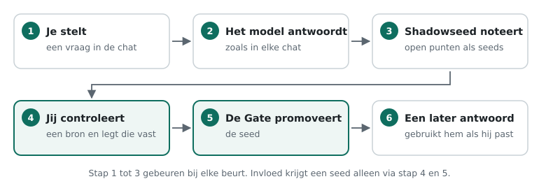

*Van vraag tot invloed. Alleen de groene stappen geven een seed invloed, en
daar heb jij de regie.*

Deze werkwijze heet **Shadow Seed Learning (SSL)**. Drie principes bepalen het
ontwerp:

- **Breed opmerken, zuinig toelaten.** Shadowseed noteert veel open punten,
  maar laat er weinig meesturen.
- **Invloed komt uit bewijs, niet uit herhaling.** Een punt dat steeds
  terugkomt is interessant, maar wordt daardoor nog niet waar.
- **Alles is na te gaan.** Elke seed heeft een tijdlijn waarin elke
  waarneming en elke beslissing staat.

Shadowseed traint het taalmodel niet. Het model blijft hetzelfde; alleen het
geheugen eromheen groeit.

**Wat Shadowseed niet belooft.** Een seed kan onjuist zijn. Een bron die jij
als gecontroleerd markeert, kan zelf fout zijn. En of antwoorden met SSL beter
worden, wordt nog onderzocht (hoofdstuk 20).

## 2. Een rondleiding

In deze handleiding volg je één voorbeeldgesprek. Een school wil een
back-upplan voor de leerlingenadministratie en vraagt Shadowseed om advies.
Na drie vragen ziet het scherm er zo uit:

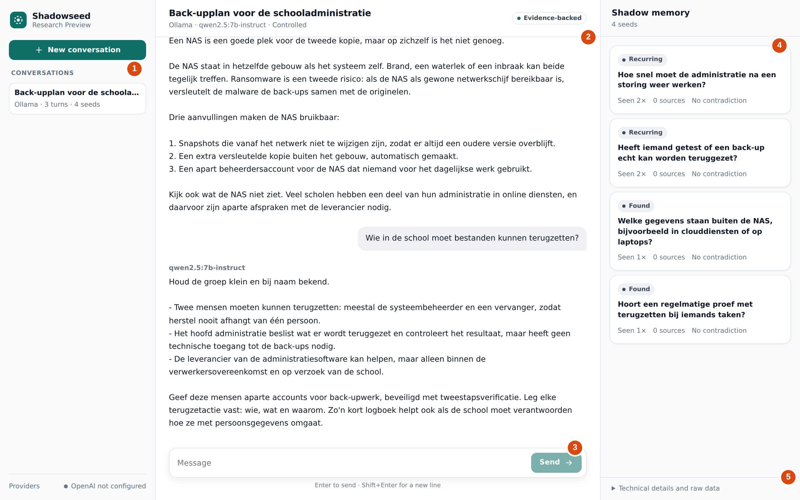

*Het voorbeeldgesprek na drie vragen. De cijfers verwijzen naar de uitleg
hieronder.*

1. **Gesprekken.** Je gesprekken, met het model, het aantal beurten en het
   aantal seeds. Bovenaan start **New conversation** een nieuw gesprek.
2. **De chat.** Hier praat je met het model, zoals in elk chatprogramma. De
   kop toont de titel, het model en de *authority mode* (hoofdstuk 11).
3. **Het invoerveld.** Typ je vraag en druk op **Enter**. **Shift+Enter**
   begint een nieuwe regel.
4. **Het schaduwgeheugen.** De seeds van dit gesprek. Elke kaart toont de
   status, de tekst en hoe vaak de seed is gezien.
5. **Technische details.** Voor wie wil zien wat er onder de motorkap
   gebeurt (hoofdstuk 9).

In het voorbeeld noteerde Shadowseed vier open punten. Twee daarvan kwamen
in een latere beurt terug. *Hoe snel moet de administratie na een storing
weer werken?* is zo'n terugkerend punt: het advies hangt ervan af, maar
niemand heeft het genoemd.

Hoe het verder gaat, lees je in deel 3. De school legt een bestuursbesluit
vast als bron (hoofdstuk 8), en bij de volgende vraag houdt het antwoord
rekening met dat besluit (hoofdstuk 9).

> **Over de voorbeelden.** De schermafbeeldingen komen uit Shadowseed 0.12.4.
> Seeds, statussen, Gate-beslissingen en tijdlijn zijn door het programma zelf
> gemaakt. De antwoorden van het model zijn voor deze handleiding vooraf
> geschreven, zodat de voorbeelden leesbaar en herhaalbaar zijn. Een echt
> model formuleert anders en vindt niet in elk gesprek zoveel seeds.

---

# Deel 2 — Installeren

Shadowseed draait op je eigen computer. Je hebt geen account nodig en je
gesprekken blijven lokaal.

## 3. Wat je nodig hebt

| | Minimaal | Aanbevolen |
| --- | --- | --- |
| Besturingssysteem | Windows 10 of 11 (64-bit), macOS op Apple silicon (M1 of nieuwer), Linux x86_64 | |
| Werkgeheugen | 8 GB | 16 GB of meer |
| Schijfruimte | 200 MB voor Shadowseed, plus ongeveer 5 GB voor een model | |
| Grafische kaart | Niet nodig | Een GPU maakt antwoorden veel sneller |
| Ollama | Versie 0.11.10 | De nieuwste versie |
| Browser | Een recente Chrome, Edge, Firefox of Safari | |

Internet heb je alleen nodig om Shadowseed en de modellen te downloaden.

**Hoe snel is het?** Dat hangt af van je computer en het model. Zonder
geschikte grafische kaart doet een middelgroot model (7B) twee tot drie
minuten over een antwoord. Met een GPU of een kleiner model gaat het veel
sneller. De offline demo heeft geen model nodig en reageert direct.

## 4. Installeren en starten

### Downloaden

Download op de releasepagina van het project op GitHub het bestand voor jouw
systeem:

| Systeem | Bestand |
| --- | --- |
| Windows | `shadowseed-web-0.12.4-windows-amd64.zip` |
| macOS (Apple silicon) | `shadowseed-web-0.12.4-darwin-arm64.zip` |
| Linux | `shadowseed-web-0.12.4-linux-x86_64.tar.gz` |

### De download controleren

Wil je zeker weten dat je bestand precies het gepubliceerde bestand is?
Download dan ook `SHA256SUMS` en bereken de controlesom:

```text
Windows (PowerShell)   Get-FileHash .\shadowseed-web-0.12.4-windows-amd64.zip
macOS                  shasum -a 256 shadowseed-web-0.12.4-darwin-arm64.zip
Linux                  sha256sum shadowseed-web-0.12.4-linux-x86_64.tar.gz
```

De uitkomst moet letter voor letter gelijk zijn aan de regel voor jouw
bestand in `SHA256SUMS`.

### Starten op Windows

1. Klik met de rechtermuisknop op het ZIP-bestand en kies *Alles uitpakken*.
2. Open de uitgepakte map en daarin de map `Shadowseed`.
3. Dubbelklik op `Shadowseed.exe`.

Windows kan waarschuwen dat de app onbekend is, omdat hij niet met een
Microsoft-certificaat is ondertekend. Kies *Meer informatie* en dan *Toch
uitvoeren*.

### Starten op macOS

1. Dubbelklik op het ZIP-bestand om het uit te pakken.
2. Klik met de rechtermuisknop op `Shadowseed`, kies *Open* en bevestig.

macOS blokkeert de eerste start, omdat de app niet door Apple is
genotariseerd. Lukt openen via de rechtermuisknop niet, voer dan één keer in
Terminal uit:

```bash
xattr -dr com.apple.quarantine /pad/naar/Shadowseed.app
```

### Starten op Linux

```bash
tar -xzf shadowseed-web-0.12.4-linux-x86_64.tar.gz
./Shadowseed/Shadowseed
```

### Na het starten

Shadowseed opent je browser op een adres als `http://127.0.0.1:8765/`. Dat
adres bestaat alleen op je eigen computer; niemand anders kan erbij. Is poort
8765 al bezet, dan kiest Shadowseed zelf een andere.

Laat het venster van Shadowseed open zolang je werkt. Sluit je het, dan stopt
het programma. Je gesprekken blijven bewaard.

> **Tip.** Opent de browser niet vanzelf? Kopieer dan het adres uit het
> venster van Shadowseed naar je browser.

## 5. Een lokaal model instellen

Om echte gesprekken te voeren heeft Shadowseed een taalmodel nodig. Het
gebruikt daarvoor **Ollama**, een gratis programma dat modellen op je eigen
computer draait.

1. Installeer Ollama via ollama.com en start het.
2. Open een terminal en download een chatmodel, bijvoorbeeld:
   `ollama pull qwen2.5:7b-instruct`
3. Download het model waarmee Shadowseed teksten vergelijkt:
   `ollama pull embeddinggemma`
4. Controleer of beide modellen er zijn: `ollama list`

**Welk chatmodel?** Elk chatmodel dat Ollama kan draaien werkt. Grotere
modellen geven betere antwoorden en vinden meer bruikbare seeds, maar vragen
meer geheugen en tijd. Uit onze metingen:

| Model | Seeds | Bruikbaar |
| --- | --- | --- |
| Qwen 2.5 7B op een gewone computer | ongeveer 1 per 8 beurten | ongeveer een kwart |
| Grote online modellen (GPT-5, GPT-6.1-sol) | veel vaker | 51 van 60 in een steekproef |

Wil je vooral zien hoe Shadowseed werkt, dan volstaat een klein model of de
offline demo. Wil je bruikbare seeds, kies dan het grootste model dat je
computer aankan.

---

# Deel 3 — Werken met Shadowseed

Van het eerste gesprek tot het beheren van je gegevens.

## 6. Een gesprek beginnen

Klik linksboven op **New conversation**. Er verschijnt een formulier:

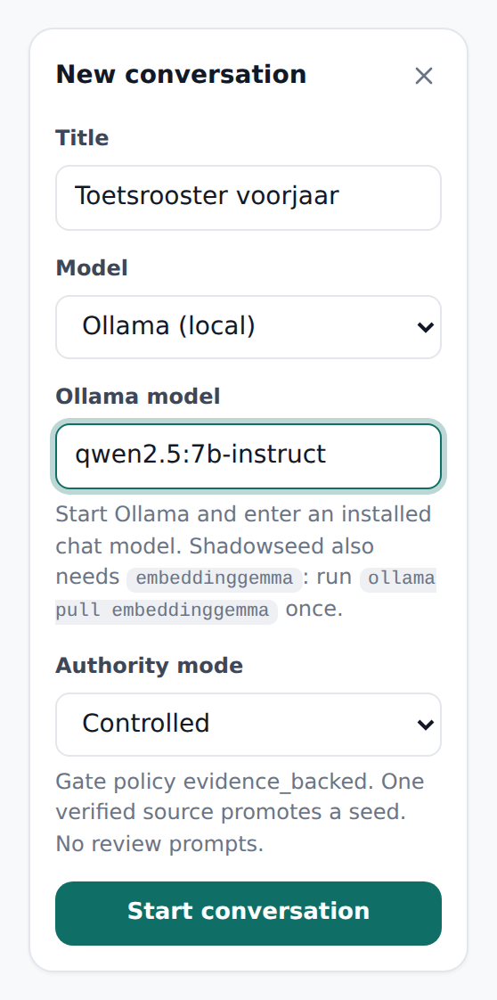{.narrow}

*Een nieuw gesprek met een lokaal model.*

1. Geef het gesprek een **Title**.
2. Kies bij **Model**:
   - *Offline demo (no model)* om de bediening te verkennen. De antwoorden
     zijn eenvoudige echo's en de seeds zijn gemarkeerd met `[FIXTURE]`.
   - *Ollama (local)* voor echte gesprekken.
3. Vul bij **Ollama model** de naam in zoals `ollama list` hem toont,
   bijvoorbeeld `qwen2.5:7b-instruct`.
4. Laat **Authority mode** op *Controlled* staan. Hoofdstuk 11 legt de andere
   modi uit.
5. Klik op **Start conversation**.

Draait Ollama niet, of ontbreekt `embeddinggemma`, dan zegt Shadowseed wat er
mis is en maakt het gesprek niet aan. Los het op en probeer het opnieuw.

Stel daarna je vraag zoals je dat in elke chat doet. Seeds verschijnen vanzelf
in het schaduwgeheugen. Hoe langer het gesprek, hoe groter de kans dat een
open punt terugkomt.

## 7. Seeds lezen

Na drie vragen staan in het voorbeeld vier seeds in het schaduwgeheugen:

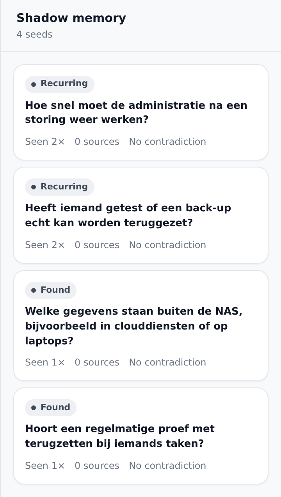{.narrow}

*Het schaduwgeheugen. Elke kaart toont de status, de tekst, hoe vaak de seed
is gezien, het aantal gecontroleerde bronnen en of er tegenspraak is.*

Elke seed is geformuleerd als een open vraag over het gesprek. De **status**
vertelt wat de seed op dit moment mag:

| Status | Betekenis | Invloed op antwoorden |
| --- | --- | --- |
| **Found** | Eén keer opgemerkt. | Nee |
| **Recurring** | In een latere beurt opnieuw opgemerkt. | Nee |
| **Supported** | Heeft een gecontroleerde bron, maar is nog niet door de Gate. | Nee |
| **Validated** | Heeft gewicht van de Gate, maar is niet gepromoveerd. | Nee |
| **Promoted** | Door de Gate. Mag meedoen als hij past bij de vraag. | Ja, als hij relevant is |
| **Used** | Gepromoveerd en minstens één keer echt gebruikt. | Ja, als hij relevant is |
| **Blocked** | Er staat tegenspraak open. | Nee |
| **Dormant** | Een tijd niet gezien. Wordt weer actief als het onderwerp terugkomt. | Nee |
| **Expired** | Vervaagd. Blijft bewaard voor de verantwoording. | Nee |

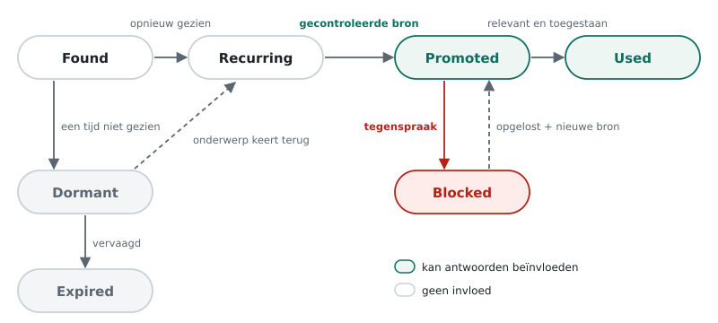

*Hoe een seed van status verandert. Met één gecontroleerde bron kan een seed
ook direct van Found naar Promoted gaan, en tegenspraak kan op elke seed.*

### Hoe Shadowseed terugkeer herkent

Twee seeds kunnen over hetzelfde onderwerp gaan zonder dezelfde vraag te
stellen. Daarom vraagt Shadowseed het model zelf of een nieuwe notitie
dezelfde open vraag is als een eerdere. Alleen "dezelfde vraag" telt als
terugkeer. In het voorbeeld herkende het model *Hoe lang mag de school
zonder administratie als de NAS uitvalt?* als dezelfde vraag als *Hoe snel
moet de administratie na een storing weer werken?*

Terugkeer is een waarneming, geen bewijs. Een seed die tien keer terugkomt
heeft in de standaardmodus nog steeds geen invloed.

### Een seed openen

Klik op een kaart om de seed te openen. Bovenaan staan zes tellers:

| Teller | Betekenis |
| --- | --- |
| **Seen** | In hoeveel beurten de seed is waargenomen |
| **Verified sources** | Hoeveel verschillende gecontroleerde bronnen hem steunen |
| **Contradiction** | Of er tegenspraak openstaat |
| **Weight** | Hoeveel gewicht de Gate hem gaf, van 0 tot 1. Nieuwe seeds staan op 0 |
| **Used in answers** | Hoe vaak hij een antwoord heeft beïnvloed |
| **Trace** | Hoe recent de seed nog aanwezig is; dit getal neemt af als hij niet terugkomt |

Daaronder staan de formulieren voor bewijs en tegenspraak, de tijdlijn en de
ruwe gegevens.

## 8. Een seed bevestigen met een bron

De school in het voorbeeld weet het antwoord op de open vraag: het bestuur
heeft vastgelegd dat de administratie binnen één werkdag weer moet werken.
Zo leg je dat vast:

1. Open de seed.
2. Vul onder **Add verified evidence** bij **Source reference** een vaste
   verwijzing in: een URL, een DOI of, zoals hier, een vindbaar document.
3. Schrijf bij **Note** in één zin waarom de bron de seed ondersteunt.
4. Vink aan: **I checked this source and confirm it supports this seed.**
5. Klik op **Record evidence**.

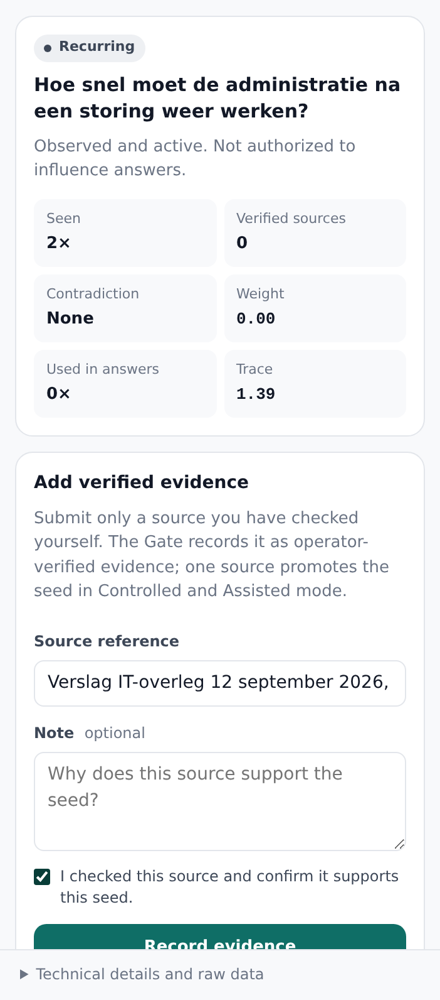{.narrow}

*Een bron vastleggen bij een terugkerende seed.*

De Gate beoordeelt de bron meteen. In de standaardmodus is één gecontroleerde
bron genoeg: de seed wordt **Promoted** en krijgt gewicht 0,20.

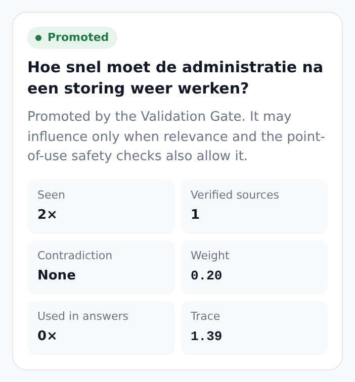{.narrow}

*Dezelfde seed na één gecontroleerde bron.*

> **Let op.** Met het vinkje verklaar je dat je de bron zelf hebt gelezen.
> Shadowseed legt die verklaring vast in het auditlogboek. Shadowseed
> controleert niet of de bron klopt; dat blijft jouw verantwoordelijkheid.

Vier regels houden de Gate betrouwbaar:

- **Vink alleen aan wat je hebt gelezen.**
- **Eén bron telt één keer.** Dezelfde verwijzing nog eens invoeren geeft
  geen extra gewicht.
- **Een antwoord van het model is geen bron.** Verwijs naar het
  oorspronkelijke document, niet naar wat het model erover zei.
- **Terugkeer is geen bron.** Ook een seed die vaak terugkomt heeft een
  bron nodig.

## 9. Wanneer een seed meedoet

Een gepromoveerde seed doet alleen mee als hij past bij de vraag die je stelt.
In het voorbeeld vraagt de school daarna hoe vaak de back-up moet draaien.
De seed over de hersteltijd past bij die vraag, en het antwoord houdt er
rekening mee:

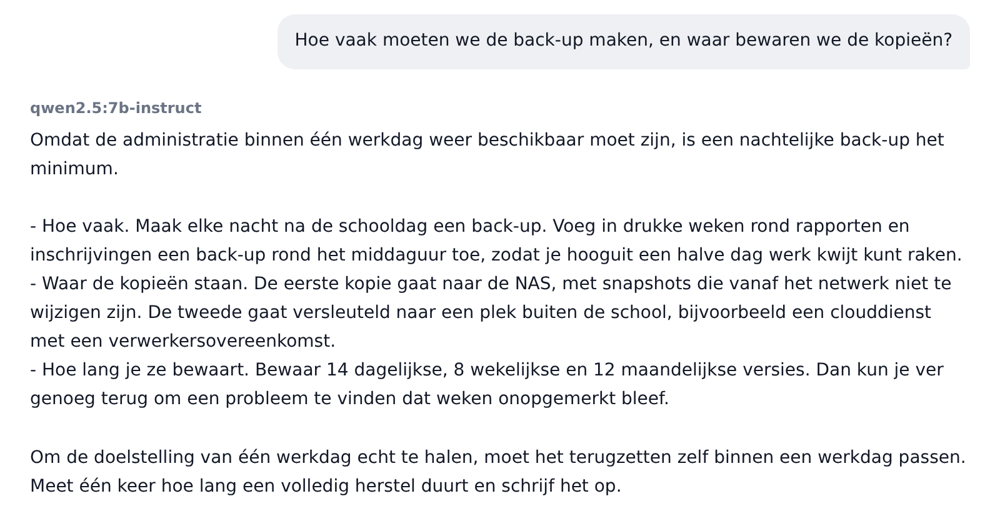

*Het antwoord gebruikt het vastgelegde besluit: één werkdag hersteltijd.*

De seed krijgt de status **Used**, en de teller laat zien hoe vaak hij is
gebruikt:

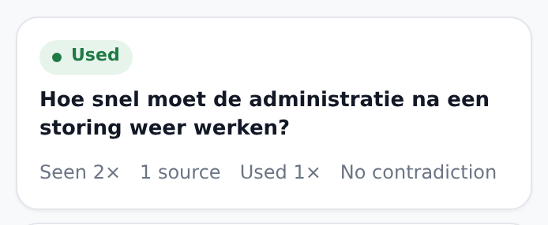{.narrow}

*Na gebruik staat de seed op Used.*

Shadowseed laat een seed alleen meedoen als op het moment van je vraag aan
alles is voldaan:

1. de seed is gepromoveerd en heeft gewicht;
2. die promotie rust op een geldige beslissing van de Gate;
3. er staat geen tegenspraak open;
4. de seed past bij je huidige vraag;
5. de laatste controle vlak voor het antwoord (*point of use*) laat hem toe.

*Promoted* betekent dus niet *altijd gebruikt*. Vraag je in het voorbeeld
naar wachtwoorden, dan blijft de seed over hersteltijd stil. Dat is de
bedoeling.

De seed gaat naar het model als achtergrond, uitdrukkelijk gemarkeerd als
niet-gecontroleerde context. Het model hoort niet dat het een feit is. En als
een seed in een antwoord is gebruikt, worden nieuwe seeds uit datzelfde
antwoord niet opgeslagen. Zo leert Shadowseed niet van zijn eigen invloed.

### De tijdlijn

Onder in de seed staat de **Timeline**. Daarin staat elke waarneming,
validatie, Gate-beslissing en elk gebruik, het nieuwste bovenaan. Klap een
regel open voor het volledige record.

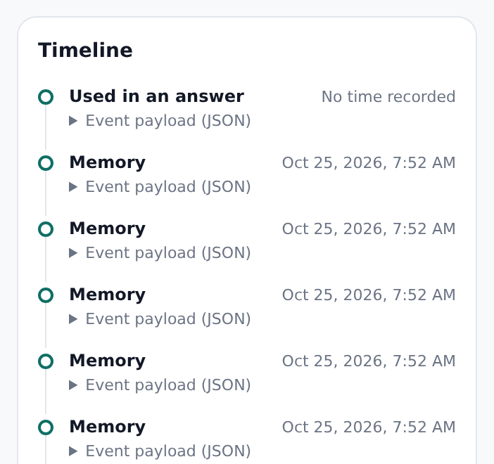{.narrow}

*De tijdlijn van de gebruikte seed.*

### Technische details

Onder het schaduwgeheugen opent **Technical details and raw data** de
gegevens van het gesprek: het Gate-beleid, het zeggenschapsprofiel, een
vingerafdruk van alle instellingen (*behavior digest*) en de volledige ruwe
gegevens van het gesprek en de laatste beurt. Met **Copy** kopieer je ze,
bijvoorbeeld voor een probleemmelding.

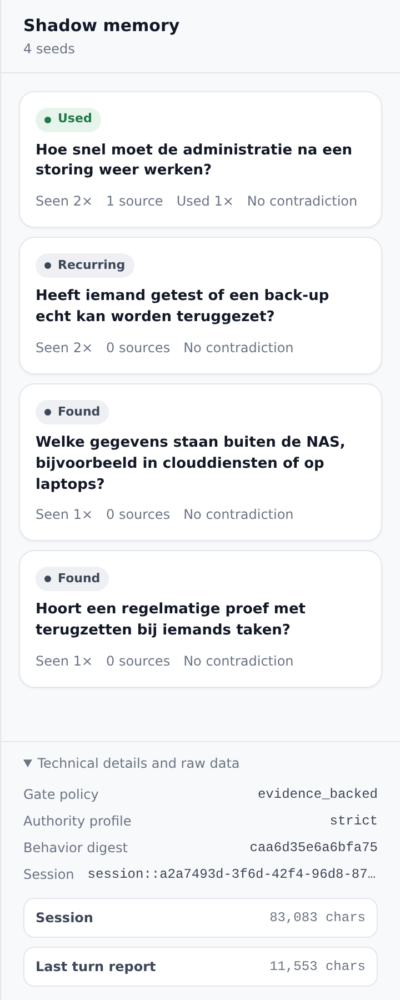{.narrow}

*Technische details van het voorbeeldgesprek.*

## 10. Een seed tegenspreken

Klopt een seed niet, of is hij achterhaald? Open hem en klik onder
**Contradiction** op **Mark as contradicted**. De seed wordt **Blocked** en kan
geen antwoord meer beïnvloeden, ook niet als hij gepromoveerd was.

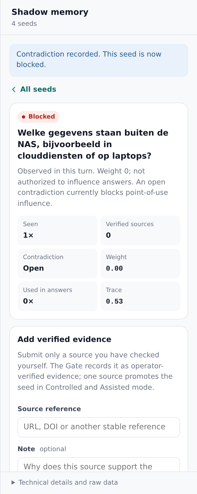{.narrow}

*Een geblokkeerde seed.*

Om de blokkade op te heffen vul je bij **Basis for resolution** in waarom de
tegenspraak niet meer geldt, en klik je op **Resolve contradiction**. Daarmee
verdwijnt alleen de blokkade. Gewicht krijgt de seed niet vanzelf terug: daar
is een nieuwe gecontroleerde bron voor nodig.

## 11. Authority modes

De *authority mode* bepaalt hoe een seed invloed kan krijgen. Je kiest hem bij
het begin van een gesprek; daarna ligt hij vast.

| Modus | Hoe een seed invloed krijgt | Gebruik hem voor |
| --- | --- | --- |
| **Controlled** (standaard) | Alleen via een bron die jij hebt gecontroleerd. Eén bron is genoeg. | Gewoon werk |
| **Assisted** | Als Controlled. Daarnaast wijst Shadowseed je op seeds die steeds terugkomen zonder bron (label *Action required*). | Als je een seintje wilt |
| **Autonomous** | Terugkeer telt als steun; een bron is niet nodig. | Alleen onderzoek |

In de modus Autonomous geeft het systeem invloed zonder jouw tussenkomst.
Gebruik hem om het mechanisme te bestuderen, niet voor antwoorden waarop je
wilt vertrouwen.

## 12. Op telefoon of tablet

Shadowseed werkt ook in een smal venster. De zijpanelen klappen dan in: het
menu linksboven opent je gesprekken, de knop **Shadow** rechtsboven het
schaduwgeheugen.

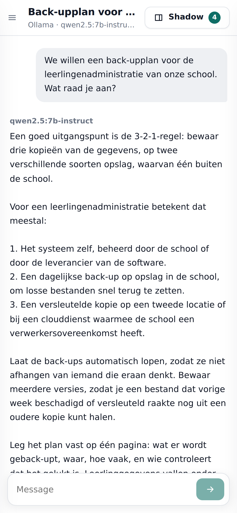{.small}

*Het voorbeeldgesprek op een telefoonscherm.*

Shadowseed draait altijd op de computer waar je het startte. Een telefoon kan
er niet via het netwerk bij; gebruik dit dus voor een smal venster op
dezelfde computer.

## 13. OpenAI gebruiken

De downloadbare app werkt alleen met lokale modellen. Wie Shadowseed als
Python-pakket installeert met de extra `openai` (hoofdstuk 21), kan ook
modellen van OpenAI gebruiken:

1. Open linksonder **Providers** en vul een **Temporary API key** in. De
   sleutel blijft alleen in het geheugen en verdwijnt als Shadowseed stopt.
2. Kies bij een nieuw gesprek *OpenAI (hosted)* en bevestig dat je vragen,
   seeds en teksten naar OpenAI gaan.
3. Die bevestiging geef je opnieuw bij elk bericht.

> **Let op.** Met OpenAI verlaat je de lokale omgeving. Wat OpenAI met je
> gegevens doet, valt onder je eigen afspraken met OpenAI.

## 14. Gegevens, back-ups en privacy

### Wat Shadowseed bewaart

Alles staat in de map `.shadowseed` in je persoonlijke map:

| Systeem | Map |
| --- | --- |
| Windows | `C:\Users\<naam>\.shadowseed` |
| macOS | `/Users/<naam>/.shadowseed` |
| Linux | `/home/<naam>/.shadowseed` |

Daarin staan je gesprekken, de antwoorden, de seeds, de Gate-beslissingen,
je bronverwijzingen en notities, en het auditlogboek. Ernaast staat
`.shadowseed-integrity`, met de sleutel die het logboek beschermt. Er gaat
niets naar buiten, tenzij je OpenAI gebruikt.

> **Let op.** Zet geen wachtwoorden, API-sleutels of andere geheimen in
> gesprekken, bronverwijzingen of notities. Gebruik verzonnen of
> geanonimiseerde gegevens als echte persoonsgegevens niet nodig zijn.

### Back-ups maken en terugzetten

De app heeft nog geen knop voor back-ups. Je gebruikt daarvoor het
Python-pakket uit dezelfde release (hoofdstuk 21):

| Opdracht | Wat het doet |
| --- | --- |
| `shadowseed workspace info` | Laat zien waar je gegevens staan en hoeveel het is |
| `shadowseed workspace backup --output <bestand>` | Maakt een volledige, consistente kopie |
| `shadowseed workspace restore <bestand>` | Zet een kopie terug |
| `shadowseed workspace delete --yes` | Verwijdert alles in `.shadowseed` en `.shadowseed-integrity` |

> **Let op.** Kies bij `backup` altijd een bestand buiten `.shadowseed`.
> Zonder `--output` komt de back-up in `.shadowseed/exports`, en die map
> verdwijnt als je de werkmap verwijdert.

Kopieer of verplaats de mappen niet met de hand. Een back-up bevat dezelfde
gegevens als het origineel; bewaar hem net zo zorgvuldig.

### Een gesprek exporteren

| Opdracht | Inhoud |
| --- | --- |
| `shadowseed export-workbench-report <sessie>` | Het hele gesprek, met controlesommen. Bevat alle tekst |
| `shadowseed export-support-bundle <sessie>` | Alleen structuur en tellingen, zonder gespreks- of seedtekst. Bedoeld voor probleemmeldingen |

De sessie-id vind je onder **Technical details and raw data**, bij
**Session**.

## 15. Problemen oplossen

| Wat je ziet | Waarschijnlijke oorzaak | Oplossing |
| --- | --- | --- |
| De browser opent niet | Geen standaardbrowser, of geblokkeerd | Kopieer het adres uit het venster van Shadowseed |
| macOS: "kan niet worden geopend" | Quarantaine op een gedownloade app | Rechtermuisknop → Open, of de `xattr`-opdracht uit hoofdstuk 4 |
| Windows: waarschuwing van SmartScreen | App niet ondertekend door Microsoft | *Meer informatie* → *Toch uitvoeren* |
| "Ollama not reachable" | Ollama draait niet | Start Ollama en probeer opnieuw |
| Melding over `embeddinggemma` | Model ontbreekt of Ollama is te oud | `ollama pull embeddinggemma`; werk Ollama bij |
| "Model not found" | Naam wijkt af van de geïnstalleerde naam | Neem de naam exact over uit `ollama list` |
| Een antwoord duurt minuten | Het model draait op de processor | Normaal zonder GPU; kies een kleiner model |
| Er verschijnen geen seeds | Kleine modellen vinden weinig | Voer het gesprek langer, of kies een groter model |
| Label *Provider needed* | Het model van dit gesprek is niet bereikbaar | Start Ollama, of stel OpenAI in |

### Shadowseed doctor

Het Python-pakket bevat een diagnoseprogramma. Het controleert de werkmap, de
database, het auditlogboek, de rechten, de schijfruimte en Ollama, en zegt hoe
je oplost wat het vindt:

```text
$ shadowseed doctor
python                   OK    3.11.15
workspace                OK    /home/jij/.shadowseed
production_integrity     OK    verified ledger head sequence 7
ollama                   WARN  not detected at http://127.0.0.1:11434
                               Start `ollama serve`, pull a model, and rerun `shadowseed doctor`.
Workbench can start.
```

De doctor zit niet in de downloadbare app. Installeer het Python-pakket uit
dezelfde release (hoofdstuk 21); het controleert dezelfde map `.shadowseed`.

## 16. Beperkingen

- **Weinig seeds met kleine modellen.** Met een 7B-model verschijnt ongeveer
  in één op de acht beurten een seed, en ongeveer een kwart daarvan is
  bruikbaar.
- **Traag zonder GPU.** Twee tot drie minuten per antwoord met een 7B-model.
- **Geen bewijs voor betere antwoorden.** Of SSL antwoorden verbetert, wordt
  nog onderzocht.
- **Seeds kunnen onjuist zijn.** Een gepromoveerde seed wordt gesteund door de
  bron die jij koos, niet bewezen.
- **Eén gebruiker, één computer.** Shadowseed is geen dienst voor meerdere
  gebruikers of via een netwerk.
- **Niet ondertekend door Apple of Microsoft.** Je systeem waarschuwt bij de
  eerste start.
- **Engelstalig scherm.** De app zelf is voorlopig alleen in het Engels.
- **Geen vergelijkknop.** Een antwoord naast hetzelfde antwoord zonder SSL
  zetten kan alleen via de web-API (hoofdstuk 19).
- **Geen back-upknop.** Back-ups maak je met het Python-pakket.

---

# Deel 4 — Testen

Voor wie een versie uitprobeert en bevindingen meldt.

## 17. Een testsessie

### Waar je op let

- Kun je de app downloaden, starten en gebruiken zonder andere software?
- Is steeds duidelijk welk model en welke authority mode actief is?
- Voelt het als een gewone chat, ook als je de seeds negeert?
- Begrijp je de statussen en de uitleg bij een seed?
- Is duidelijk dat jij een bron moet controleren, en dat terugkeer geen bewijs
  is?
- Helpen de foutmeldingen als Ollama of een model ontbreekt?
- Kun je een gesprek sluiten en later heropenen zonder iets kwijt te raken?

### Zo test je

1. Begin met de offline demo. Die laat de bediening zien, niet de kwaliteit.
2. Ga daarna over op Ollama met een echt model en voer gesprekken van acht
   beurten of meer. Seeds en terugkeer hebben tijd nodig.
3. Noteer bij elke sessie het model, de authority mode en wat je deed.

### Een probleem melden

Een goede melding bevat:

- wat je probeerde te doen;
- het model en de authority mode;
- de kortste reeks stappen waarmee het probleem terugkomt;
- wat je verwachtte en wat er gebeurde;
- of er in die beurt een seed is gebruikt.

Zet er geen persoonsgegevens of geheimen in. Voeg liever een supportbundel
toe dan een volledig rapport (hoofdstuk 14).

> **Belangrijk.** Kan iemand het gewicht of de status van een seed
> veranderen zonder langs de Gate te gaan? Dan is dat een ernstig gebrek.
> Meld het met voorrang.

### Supportbundels verzamelen

Een supportbundel bevat structuur en tellingen, maar geen gespreks- of
seedtekst. Wie een test met meerdere testers coördineert, voegt bundels samen
met `scripts/aggregate_support_bundles.py`. Bewerk een bundel niet met de
hand: de integriteitscontrole faalt dan.

---

# Deel 5 — Onderzoek

Het model achter Shadowseed, en hoe je het eerlijk onderzoekt.

## 18. Het SSL-model

### Levenscyclus

Een seed doorloopt vaste stappen. Elke stap staat los van de andere, en alleen
de Gate verandert zeggenschap.

| Stap | Wat er gebeurt |
| --- | --- |
| **Detectie** | Het model leest de vraag, het conceptantwoord en hooguit vier eerdere beurten, en stelt nul tot vijf open punten voor (prompt `detector_current_pair` v0.6) |
| **Toelating** | Een voorstel wordt een seed met gewicht 0 als het één vraag is, of één Engelse bewering die geen kale opsomming is |
| **Terugkeer** | Het sessiemodel beoordeelt of een nieuwe notitie dezelfde open vraag is als een eerdere (ADR-012). Tekstgelijkenis geldt als ondergrens (0,3) en als terugvaloptie |
| **Spoor** | *Trace* registreert recente aanwezigheid en neemt af met een halfwaardetijd. Seeds worden *Dormant* en later *Expired* |
| **Gate** | De enige plek waar gewicht en status veranderen |
| **Point of use** | De laatste controle vlak voor een antwoord |

### Gate-beleid

| Beleid | Accepteert |
| --- | --- |
| `evidence_backed` | Alleen gecontroleerde externe steun. In Controlled en Assisted promoveert één bron (drempel 0,2, ADR-011) |
| `exploratory` | Genoeg terugkeer, of gecontroleerde externe steun |
| `legacy_evidence_required` | Historische drempels, bewaard voor vergelijkbaarheid |

Een bron heeft een niet-lege `source_ref`. Die verwijzing is de identiteit van
het bewijs: dezelfde verwijzing telt nooit twee keer, ook niet via een andere
route. Tegenspraak is een apart record met id, reden, status en
oplossingsgrond. Oplossen heft de blokkade op, maar herstelt geen gewicht.

### Point of use

Voordat een seed een antwoord mag beïnvloeden, controleert
`AgentSafetyContract.decide_and_record` vier dingen: positief gewicht, status
*promoted*, geen blokkerende tegenspraak, en een geldige Gate-beslissing voor
de huidige zeggenschapsversie van de seed. Zowel toestemming als weigering
wordt vastgelegd, en elke toestemming verwijst naar de Gate-beslissing
waarop ze rust. Daardoor is achteraf te zien of een verouderde toestemming is
gebruikt.

### Twee soorten geheugen

Onder `evidence_backed` is terugkeer alleen een spoor: een waarneming die je
kunt bestuderen. Onder `exploratory` kan terugkeer na drie keer als steun
tellen. Het product gebruikt standaard `evidence_backed`.

## 19. Effect van SSL aantonen

Twee antwoorden verschillen altijd een beetje, ook zonder SSL. Een ander
antwoord is dus geen bewijs dat een seed invloed had. Schrijf een effect
alleen aan SSL toe als:

1. de seed gepromoveerd was;
2. hij voor die beurt als relevant was geselecteerd;
3. de controle bij gebruik hem toeliet;
4. hij daadwerkelijk is meegegeven, zoals vastgelegd in het beurtrapport en
   de tijdlijn.

Voor een eerlijke vergelijking stuur je een beurt via de web-API
(hoofdstuk 24) met `compare_without_ssl: true`. Shadowseed maakt dan een
tweede antwoord met hetzelfde model, dezelfde zichtbare geschiedenis en
dezelfde vraag, maar zonder seeds. Die vergelijking verandert niets aan de
opgeslagen toestand. Je vindt haar onder **Technical details and raw data**
→ **Last turn comparison**.

## 20. Studies en bewijs

De repository bevat vooraf vastgelegde studies en hun uitkomsten:

| Studie | Vraag | Stand |
| --- | --- | --- |
| Seedkalibratie (`docs/research/seed-calibration.md`) | Hoe bruikbaar zijn gevonden seeds, en hoe betrouwbaar is de herkenning van terugkeer? | Afgerond |
| Detectorkalibratie (`docs/research/detector-calibration.md`) | Verbetert een andere detectieprompt de seeds van Qwen 2.5 7B? | Afgerond: meer seeds, niet betere |
| Bewijseffectiviteit (`docs/research/evidence-efficacy.md`) | Verbetert een geautoriseerde seed antwoorden, vergeleken met SSL uit en met zelfkritiek? | Pilot |

Vier principes gelden voor elke studie:

- leg de opzet en de beslisregel vast vóór de meting;
- beoordeel blind, en leg de oordelen vast voordat je de sleutel opent;
- leg de exacte modelversie, de broncommit en de promptversies vast;
- behandel wat het model zegt als waarneming, nooit als bewijs.

Onderzoekshulpmiddelen staan in het pakket `research/` en in `scripts/`.
Uitkomsten staan met hun herkomst onder `benchmarks/`.

---

# Deel 6 — Ontwikkeling

Werken met de broncode, de opbouw van het systeem en de interfaces.

## 21. Werken vanuit de broncode

### Installeren

Uit een release, zonder Git:

```bash
python -m pip install shadowseed-0.12.4-py3-none-any.whl
```

Uit de repository:

```bash
git clone https://github.com/E-AI-MODEL/shadowseed-pro.git
cd shadowseed-pro
python -m pip install -e ".[test]"
```

Python 3.10 of nieuwer is vereist. Optionele onderdelen:

| Extra | Voegt toe |
| --- | --- |
| `openai` | OpenAI-modellen en -embeddings |
| `models` | Hugging Face en Sentence Transformers |
| `workbench` | De oude Gradio-interface |
| `vector`, `build`, `standalone-build`, `security` | Vectoropslag, builds en beveiligingscontroles |
| `dev` | Alles hierboven |

### Testen en controleren

```bash
python -m pytest -q            # volledige testsuite
ruff check src tests scripts   # stijl en fouten
uv lock --check                # lockfile klopt met pyproject.toml
```

De webclient is een Next.js-app in `apps/web`. Bouw hem en kopieer het
resultaat naar het Python-pakket met `scripts/sync_web_assets.py`.

### Regels voor wijzigingen

- De Validation Gate is de enige route naar zeggenschap. Voeg geen tweede
  route toe.
- De velden `weight`, `status`, `evidence_count` en `contradiction_score`
  kun je niet rechtstreeks toewijzen; tests bewaken dat.
- Een wijziging van het zeggenschapsmodel vraagt een ADR in
  `docs/architecture/adr/`.
- Elke wijziging gaat via een pull request met groene CI.

## 22. Architectuur

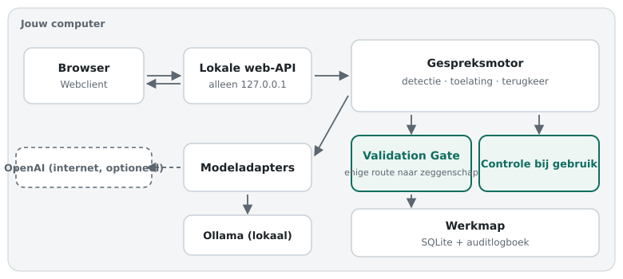

*De onderdelen van Shadowseed. Alles draait op je eigen computer; OpenAI is
optioneel.*

| Onderdeel | Locatie | Rol |
| --- | --- | --- |
| Gespreksmotor | `src/shadowseed/` (`chat.py`, `manager.py`, `lifecycle.py`) | Gesprek, seeds en levenscyclus |
| Detectie | `src/shadowseed/detection/` | Detectieprompts en het uitlezen van het antwoord |
| Toelating en terugkeer | `intake.py`, `recurrence_*.py` | Welke voorstellen seeds worden, en wanneer een seed terugkeert |
| Gate | `src/shadowseed/gate/` | De Validation Gate en haar logboek |
| Opslag | `src/shadowseed/storage/` | SQLite-werkmap en integriteitslogboek |
| Applicatie | `src/shadowseed/application/` | Werkmap, limieten, gezondheidscontroles |
| Adapters | `src/shadowseed/adapters/` | Ollama, OpenAI, Hugging Face, embeddings |
| Web-API | `src/shadowseed_webapi/` | HTTP-server op loopback en het startprogramma |
| Webclient | `apps/web/` | De interface in de browser |
| Oude Workbench | `src/shadowseed/workbench/` | Gradio-interface, alleen op verzoek |
| Onderzoek | `research/` | Benchmarks en studies |

De ontwerpbesluiten staan in `docs/architecture/adr/` (ADR-001 tot en met
ADR-012). Begin met ADR-001 (de Gate als enige bron van zeggenschap), ADR-006
(de grens van het lokale productieprofiel), ADR-011 (promotie met één bron) en
ADR-012 (herkenning van terugkeer door het model).

## 23. De opdrachtregel

| Opdracht | Doel |
| --- | --- |
| `shadowseed-web [--port N] [--workspace MAP] [--no-browser]` | De app starten (standaardpoort 8765, alleen loopback) |
| `shadowseed-web --self-test --workspace MAP` | De ingebouwde zelftest draaien |
| `shadowseed chat --backend fixture\|ollama\|openai` | Chatten in de terminal |
| `shadowseed doctor [--json] [--workspace MAP]` | De installatie controleren |
| `shadowseed init [--workspace MAP]` | Een werkmap aanmaken |
| `shadowseed workspace info\|backup\|restore\|delete` | De werkmap beheren |
| `shadowseed-workbench [--legacy-gradio]` | Het bureaubladprogramma starten; met `--legacy-gradio` de oude interface |
| `shadowseed export-workbench-report <sessie>` | Een gesprek exporteren als volledig rapport |
| `shadowseed export-support-bundle <sessie>` | Een supportbundel zonder tekst exporteren |

Elke opdracht toont met `--help` al haar opties. `docs/usage/cli.md`
beschrijft de opdrachten voor onderzoek en benchmarks.

## 24. De web-API

De server luistert alleen op `127.0.0.1`. Alle routes beginnen met `/api/v1`.

| Methode | Route | Doel |
| --- | --- | --- |
| GET | `/health` | Gezondheidscontrole |
| GET | `/providers` | Status van de modelaanbieders |
| POST | `/providers/openai/credential` | Een tijdelijke OpenAI-sleutel instellen |
| POST | `/providers/openai/credential/clear` | Die sleutel wissen |
| GET | `/sessions` | Gesprekken opvragen |
| POST | `/sessions` | Een gesprek aanmaken (`title`, `backend`, `model_id`, `authority_mode`, `external_confirmed`) |
| GET | `/sessions/{id}` | Een gesprek lezen |
| POST | `/sessions/{id}/turns` | Een bericht sturen (`question`, `request_id`, optioneel `compare_without_ssl`, `external_confirmed`) |
| GET | `/sessions/{id}/seeds/{seed}` | Een seed met tijdlijn lezen |
| POST | `/sessions/{id}/seeds/{seed}/evidence` | Een bron vastleggen (`source_ref`, `note`, `operator_verified: true`, `request_id`) |
| POST | `/sessions/{id}/seeds/{seed}/contradictions` | Tegenspraak vastleggen (`request_id`) |
| POST | `/sessions/{id}/seeds/{seed}/contradictions/resolve` | Tegenspraak oplossen (grond verplicht, `request_id`) |

**Veilig herhalen.** Een beurt en de drie seedacties vragen een `request_id`.
Dezelfde id opnieuw sturen is veilig: de actie gebeurt één keer. Een id die
opnieuw wordt gebruikt met andere inhoud, wordt geweigerd. Een gesprek
aanmaken en de OpenAI-sleutel instellen of wissen hebben geen `request_id`;
herhaal je die, dan gebeurt de actie opnieuw.

**Afscherming.** Verzoeken vanaf een andere website, of met een `Host`-header
die niet naar loopback wijst, worden geweigerd.

## 25. Builds en releases

| Stap | Wat er gebeurt |
| --- | --- |
| **CI** bij elke pull request | Tests op Python 3.10 en 3.12, controles van het lokale productieprofiel op Windows, macOS en Linux, een strikte audit van de meegeleverde afhankelijkheden, en bevroren builds voor de drie platforms |
| **Release Workbench** (handmatig) | Publiceert de versie uit `pyproject.toml` vanaf de exacte commit op `main`, nadat CI op die commit groen is. Bouwt de drie downloads, `SHA256SUMS`, `PROVENANCE.json`, een SBOM, het wheel en de sdist |
| **Production Release Assurance** (automatisch) | Controleert op de gepubliceerde tag de attestaties, controlesommen en herkomst |

Een versie heet pas *production-ready/local* als ook een echte gebruiksronde
met Ollama en `shadowseed doctor` op de gepubliceerde versie is vastgelegd,
zonder openstaande ernstige bevindingen (P0/P1). Release notes staan in
`docs/workbench/release-<versie>.md`.

---

# Deel 7 — Beveiliging en beheer

Wat het lokale profiel wel en niet beschermt, en hoe je Shadowseed
betrouwbaar laat draaien.

## 26. Beveiligingsmodel

| Shadowseed claimt wel | Shadowseed claimt niet |
| --- | --- |
| De server is alleen bereikbaar via `127.0.0.1`, en de `Host`-header wordt gecontroleerd tegen DNS-rebinding | Bescherming tegen een gecompromitteerd besturingssysteem of beheerder |
| Handelingen die zeggenschap veranderen, worden aan een vertrouwde lokale gebruiker toegeschreven | Scheiding tussen gebruikers, of veiligheid op een vijandig netwerk |
| Een vlag van de client alleen geeft nooit zeggenschap | Dat een bron die de gebruiker als gecontroleerd markeert, klopt |
| De Gate en de controle bij gebruik zijn de enige route naar invloed | Algemene bescherming tegen prompt-injectie |
| Knoeien met de geschiedenis, of terugzetten naar een oudere toestand, is aantoonbaar | Betere antwoorden in het algemeen |
| Operationele logboeken bevatten zo min mogelijk inhoud | Veilig wissen voorbij wat het bestandssysteem biedt |
| Releases zijn via controlesommen en herkomst gekoppeld aan een exacte commit | |

Het volledige dreigingsmodel staat in
`docs/architecture/production-threat-model.md`.

## 27. Betrouwbaar draaien

- **Limieten.** Te grote invoer wordt geweigerd voordat er iets wordt
  opgeslagen. Een aanroep naar een model stopt na 120 seconden en wordt niet
  automatisch herhaald. Een mislukte beurt verandert de opgeslagen toestand
  niet.
- **Rechten.** Op macOS en Linux kan alleen de eigenaar de werkmap lezen. Op
  Windows beschermt het gebruikersaccount de werkmap.
- **Integriteit.** Het auditlogboek legt alle zeggenschapsgebeurtenissen vast,
  beschermd door de sleutel in `.shadowseed-integrity`. Herstel een werkmap
  nooit door die map te verwijderen; zet een gecontroleerde back-up terug.
- **Back-ups.** Gebruik `shadowseed workspace backup --output <bestand>` met
  een bestand buiten de werkmap (hoofdstuk 14).
- **Containers.** `Dockerfile.workbench` is bedoeld voor ontwikkeling. Publiceer
  de poort alleen op loopback: `-p 127.0.0.1:7860:7860`.
- **Diagnose.** `shadowseed doctor` onderscheidt een bruikbare toestand van
  integriteitsproblemen en ontbrekende onderdelen.

Beheerprocedures: `docs/operations/production-local-recovery.md` en
`docs/operations/production-local-release.md`.

## 28. Instellingen

| Instelling | Standaard | Betekenis |
| --- | --- | --- |
| `--port` | 8765 | Voorkeurspoort; is die bezet, dan kiest Shadowseed een andere |
| `--workspace` | `~/.shadowseed` | De gegevensmap |
| `OLLAMA_HOST` | `http://localhost:11434` | Adres van Ollama |
| `OPENAI_API_KEY` | niet ingesteld | OpenAI-sleutel voor het Python-pakket; de app gebruikt de tijdelijke sleutel |
| Authority mode | Controlled | Per gesprek te kiezen |
| Embeddingmodel | `embeddinggemma` | Nodig voor gesprekken met Ollama |

---

# Bijlagen

## A. Begrippenlijst

| Nederlands | Op het scherm | Betekenis |
| --- | --- | --- |
| Seed | Seed | Een notitie over een mogelijk open punt in het gesprek |
| Schaduwgeheugen | Shadow memory | Alle seeds van een gesprek met hun geschiedenis |
| Validatiepoort | Validation Gate | De enige plek waar een seed invloed krijgt of verliest |
| Authority mode | Authority mode | Controlled, Assisted of Autonomous |
| Zeggenschap | Authority | Het recht van een seed om antwoorden te beïnvloeden |
| Gewicht | Weight | Hoeveel zeggenschap de Gate gaf, van 0 tot 1 |
| Spoor | Trace | Hoe recent een seed nog aanwezig is |
| Terugkeer | Recurrence | Een open punt dat in een latere beurt terugkomt |
| Gecontroleerde bron | Verified evidence | Een bron die de gebruiker zelf heeft gelezen |
| Tegenspraak | Contradiction | Een vastgelegd bezwaar dat een seed blokkeert |
| Controle bij gebruik | Point of use | De laatste controle vlak voor een antwoord |
| Gate-beleid | Gate policy | `evidence_backed` of `exploratory` |
| Werkmap | Workspace | De gegevensmap `.shadowseed` |
| Auditlogboek | Audit ledger | Het beschermde verslag van alle zeggenschapsgebeurtenissen |
| Offline demo | Offline demo (no model) | Werken zonder model, om de bediening te verkennen |

## B. Veelgestelde vragen

**Stuurt Shadowseed mijn gesprekken ergens naartoe?**
Nee, tenzij je OpenAI kiest. Met Ollama blijft alles op je computer.

**Waarom zie ik zo weinig seeds?**
Kleine modellen vinden weinig open punten. Langere gesprekken en grotere
modellen helpen.

**Ik heb een bron toegevoegd, maar de seed wordt niet gebruikt. Hoe kan dat?**
Een gepromoveerde seed doet alleen mee als hij past bij je vraag. Stel een
vraag over het onderwerp van de seed.

**Kan ik het gewicht van een seed zelf instellen?**
Nee. Alleen de Gate verandert zeggenschap. Dat is een bewuste waarborg.

**Wordt een seed die vaak terugkomt vanzelf gepromoveerd?**
Niet in Controlled en Assisted. Daar is altijd een gecontroleerde bron nodig.
Alleen in Autonomous telt terugkeer mee.

**Is een gepromoveerde seed waar?**
Niet per se. Hij wordt gesteund door de bron die jij hebt gecontroleerd.

**Mag ik Shadowseed in mijn bedrijf gebruiken?**
De licentie is PolyForm Noncommercial 1.0.0. Voor commercieel gebruik is
aparte toestemming nodig.

## C. Over dit document

| | |
| --- | --- |
| Geldt voor | Shadowseed 0.12.4 |
| Edities | Nederlands en Engels, als Markdown en als PDF in `docs/manual/` |
| Schermafbeeldingen | Shadowseed 0.12.4 met een vooraf geschreven voorbeeldgesprek (zie hoofdstuk 2) |
| Licentie | PolyForm Noncommercial License 1.0.0 |

Fouten of suggesties? Meld ze als issue in de repository.
