# Shadowseed — Manual

**Version 0.12.4 · Research Preview · October 2026**

## About this manual

Shadowseed is a chat application that keeps track of what is still open in a
conversation. This manual explains how to install it, how to work with it and
how it works inside. It is written for five kinds of reader. You do not need to
read all of it:

| You are… | Read |
| --- | --- |
| **User**: you want to work with Shadowseed | Parts 1, 2 and 3 |
| **Tester**: you try out a new version and report findings | Parts 1, 2, 3 and 4 |
| **Researcher**: you study Shadow Seed Learning | Parts 1, 3 and 5 |
| **Developer**: you build on Shadowseed or change it | Parts 1, 5 and 6 |
| **Specialist** in security, privacy or operations | Parts 1, 6 and 7 |

Buttons and fields are shown in **bold**, exactly as they appear on screen. A
glossary at the end lists the main terms. A Dutch edition is available as
`shadowseed-handleiding-nl`.

> **Caution.** Shadowseed is a *Research Preview*: it works and is tested, but
> it is not meant for decisions with serious consequences, such as in health
> care, law, finance or employment. Chapter 16 lists the limitations.

## Contents

- Part 1 — Getting to know Shadowseed
- Part 2 — Installation
- Part 3 — Working with Shadowseed
- Part 4 — Testing
- Part 5 — Research
- Part 6 — Development
- Part 7 — Security and operations
- Appendices

---

# Part 1 — Getting to know Shadowseed

What Shadowseed does, and a tour based on an example conversation.

## 1. What Shadowseed does

An ordinary chat forgets what was left open along the way. You ask something,
the model answers, and an assumption nobody checked drops out of sight.
Shadowseed holds on to those open points.

With every answer, Shadowseed looks for questions that are still unanswered: a
missing figure, an assumption that was not checked, a situation that was not
covered. It stores such a point as a **seed**, a short note in the margin of
the conversation. Together these notes form the **Shadow memory**.

A seed is a hunch, not a fact. That is why a new seed has no influence on the
answers at all. A seed gains influence only when you have checked a source that
supports it and the **Validation Gate** has accepted that source. Even then,
Shadowseed uses the seed only when it fits the question you are asking at that
moment.

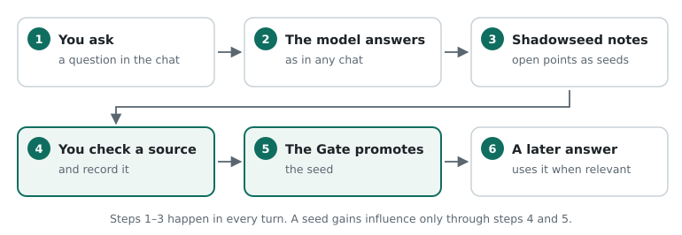

*From question to influence. Only the green steps give a seed influence, and
you are in charge of those.*

This way of working is called **Shadow Seed Learning (SSL)**. Three principles
shape the design:

- **Notice widely, admit sparingly.** Shadowseed notes many open points but
  lets few of them steer.
- **Influence comes from evidence, not from repetition.** A point that keeps
  coming back is interesting, but that does not make it true.
- **Everything can be traced.** Every seed has a timeline with every
  observation and every decision.

Shadowseed does not retrain the language model. The model stays the same; only
the memory around it grows.

**What Shadowseed does not promise.** A seed can be wrong. A source you mark as
checked can itself be wrong. And whether SSL makes answers better is still
being studied (chapter 20).

## 2. A tour

This manual follows one example conversation throughout. A school wants a
backup plan for its student administration and asks Shadowseed for advice.
After three questions the screen looks like this:

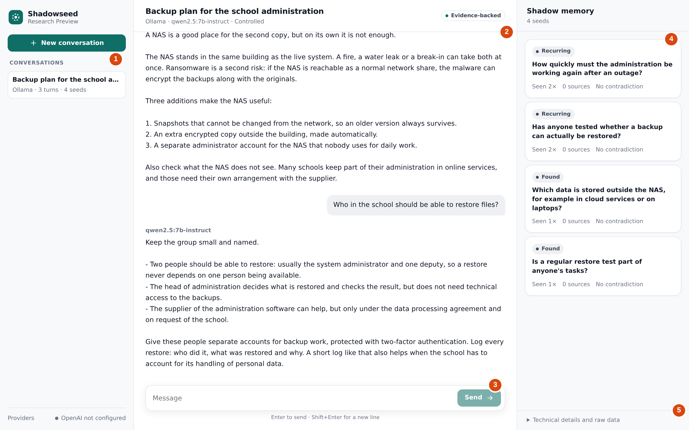

*The example conversation after three questions. The numbers refer to the
explanation below.*

1. **Conversations.** Your conversations, with the model, the number of turns
   and the number of seeds. At the top, **New conversation** starts a new one.
2. **The chat.** Here you talk to the model, as in any chat application. The
   header shows the title, the model and the authority mode (chapter 11).
3. **The message box.** Type your question and press **Enter**.
   **Shift+Enter** starts a new line.
4. **The Shadow memory.** The seeds of this conversation. Each card shows the
   status, the text and how often the seed was seen.
5. **Technical details.** For anyone who wants to look under the hood
   (chapter 9).

In the example Shadowseed noted four open points, and two of them came back
in a later turn. *How quickly must the administration be working again after
an outage?* is one of them: the advice depends on it, but nobody mentioned
it.

Part 3 continues the story. The school records a board decision as a source
(chapter 8), and the next answer takes that decision into account
(chapter 9).

> **About the examples.** The screenshots come from Shadowseed 0.12.4. Seeds,
> statuses, Gate decisions and the timeline were produced by the program
> itself. The model's answers were written in advance for this manual, so the
> examples are readable and repeatable. A real model words things differently
> and does not find this many seeds in every conversation.

---

# Part 2 — Installation

Shadowseed runs on your own computer. You need no account, and your
conversations stay local.

## 3. What you need

| | Minimum | Recommended |
| --- | --- | --- |
| Operating system | Windows 10 or 11 (64-bit), macOS on Apple silicon (M1 or later), Linux x86_64 | |
| Memory | 8 GB | 16 GB or more |
| Disk space | 200 MB for Shadowseed, plus about 5 GB per model | |
| Graphics card | Not required | A GPU makes answers much faster |
| Ollama | Version 0.11.10 | The latest version |
| Browser | A recent Chrome, Edge, Firefox or Safari | |

You need the internet only to download Shadowseed and the models.

**How fast is it?** That depends on your computer and the model. Without a
suitable graphics card, a medium-sized model (7B) takes two to three minutes
per answer. A GPU or a smaller model is much faster. The offline demo needs no
model and responds at once.

## 4. Installing and starting

### Download

On the project's GitHub release page, download the file for your system:

| System | File |
| --- | --- |
| Windows | `shadowseed-web-0.12.4-windows-amd64.zip` |
| macOS (Apple silicon) | `shadowseed-web-0.12.4-darwin-arm64.zip` |
| Linux | `shadowseed-web-0.12.4-linux-x86_64.tar.gz` |

### Verify the download

To be sure your file is exactly the published file, also download
`SHA256SUMS` and compute the checksum:

```text
Windows (PowerShell)   Get-FileHash .\shadowseed-web-0.12.4-windows-amd64.zip
macOS                  shasum -a 256 shadowseed-web-0.12.4-darwin-arm64.zip
Linux                  sha256sum shadowseed-web-0.12.4-linux-x86_64.tar.gz
```

The result must match the line for your file in `SHA256SUMS` character for
character.

### Start on Windows

1. Right-click the ZIP file and choose *Extract All*.
2. Open the extracted folder, then the `Shadowseed` folder inside it.
3. Double-click `Shadowseed.exe`.

Windows may warn that the app is unrecognised, because it is not signed with a
Microsoft certificate. Choose *More info*, then *Run anyway*.

### Start on macOS

1. Double-click the ZIP file to extract it.
2. Right-click `Shadowseed`, choose *Open* and confirm.

macOS blocks the first start because the app is not notarised by Apple. If
opening with a right-click does not work, run this once in Terminal:

```bash
xattr -dr com.apple.quarantine /path/to/Shadowseed.app
```

### Start on Linux

```bash
tar -xzf shadowseed-web-0.12.4-linux-x86_64.tar.gz
./Shadowseed/Shadowseed
```

### After starting

Shadowseed opens your browser at an address such as `http://127.0.0.1:8765/`.
That address exists only on your own computer; nobody else can reach it. If
port 8765 is already in use, Shadowseed picks another one.

Keep the Shadowseed window open while you work. If you close it, the program
stops. Your conversations are kept.

> **Tip.** If the browser does not open by itself, copy the address from the
> Shadowseed window into your browser.

## 5. Setting up a local model

For real conversations Shadowseed needs a language model. It uses **Ollama**
for that, a free program that runs models on your own computer.

1. Install Ollama from ollama.com and start it.
2. Open a terminal and download a chat model, for example:
   `ollama pull qwen2.5:7b-instruct`
3. Download the model Shadowseed uses to compare texts:
   `ollama pull embeddinggemma`
4. Check that both models are there: `ollama list`

**Which chat model?** Any chat model Ollama can run works. Larger models give
better answers and find more useful seeds, but need more memory and time. From
our measurements:

| Model | Seeds | Useful |
| --- | --- | --- |
| Qwen 2.5 7B on an ordinary computer | about 1 per 8 turns | about a quarter |
| Large hosted models (GPT-5, GPT-6.1-sol) | much more often | 51 of 60 in a sample |

If you mainly want to see how Shadowseed works, a small model or the offline
demo is enough. If you want useful seeds, choose the largest model your
computer can handle.

---

# Part 3 — Working with Shadowseed

From the first conversation to managing your data.

## 6. Starting a conversation

Click **New conversation** at the top left. A form appears:

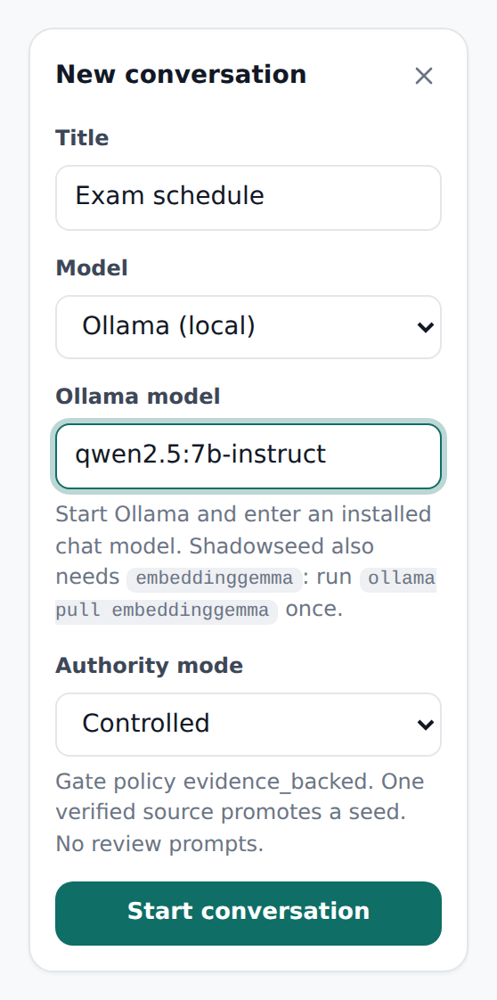{.narrow}

*A new conversation with a local model.*

1. Give the conversation a **Title**.
2. Choose a **Model**:
   - *Offline demo (no model)* to explore the controls. The answers are simple
     echoes and the seeds are marked `[FIXTURE]`.
   - *Ollama (local)* for real conversations.
3. Under **Ollama model**, enter the name exactly as `ollama list` shows it,
   for example `qwen2.5:7b-instruct`.
4. Leave **Authority mode** on *Controlled*. Chapter 11 explains the other
   modes.
5. Click **Start conversation**.

If Ollama is not running, or `embeddinggemma` is missing, Shadowseed says what
is wrong and does not create the conversation. Fix it and try again.

Then ask your question as you would in any chat. Seeds appear in the Shadow
memory by themselves. The longer the conversation, the more likely an open
point comes back.

## 7. Reading seeds

After three questions, the example has four seeds in the Shadow memory:

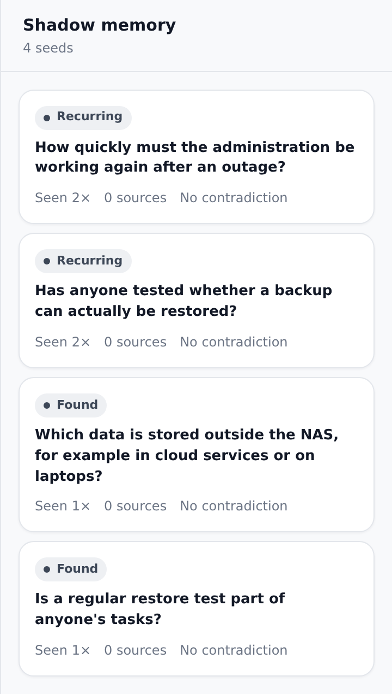{.narrow}

*The Shadow memory. Each card shows the status, the text, how often the seed
was seen, the number of verified sources and whether it is contradicted.*

Each seed is phrased as an open question about the conversation. Its
**status** tells you what the seed may do right now:

| Status | Meaning | Influence on answers |
| --- | --- | --- |
| **Found** | Noticed once. | No |
| **Recurring** | Noticed again in a later turn. | No |
| **Supported** | Has a verified source but has not passed the Gate. | No |
| **Validated** | Has weight from the Gate but is not promoted. | No |
| **Promoted** | Passed the Gate. May take part when it fits the question. | Yes, when relevant |
| **Used** | Promoted and actually used at least once. | Yes, when relevant |
| **Blocked** | A contradiction is open. | No |
| **Dormant** | Not seen for a while. Becomes active again when the topic returns. | No |
| **Expired** | Faded out. Kept for the record. | No |

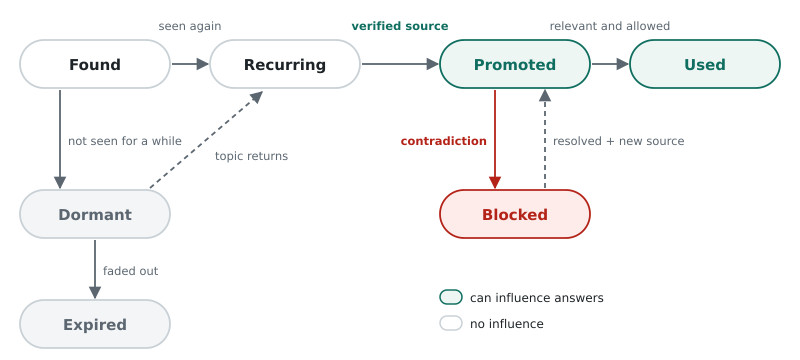

*How a seed changes status. With one verified source a seed can also go
straight from Found to Promoted, and any seed can be contradicted.*

### How Shadowseed recognises recurrence

Two seeds can share a topic without asking the same question. So Shadowseed
asks the model itself whether a new note is the same open question as an
earlier one. Only "the same question" counts as recurrence. In the example the
model recognised *How long may the school be without the administration if the
NAS fails?* as the same question as *How quickly must the administration be
working again after an outage?*

Recurrence is an observation, not evidence. A seed that comes back ten times
still has no influence in the default mode.

### Opening a seed

Click a card to open the seed. Six counters appear at the top:

| Counter | Meaning |
| --- | --- |
| **Seen** | In how many turns the seed was observed |
| **Verified sources** | How many different checked sources support it |
| **Contradiction** | Whether a contradiction is open |
| **Weight** | How much weight the Gate gave it, from 0 to 1. New seeds start at 0 |
| **Used in answers** | How often it influenced an answer |
| **Trace** | How recently the seed was present; this number falls when it does not return |

Below them are the forms for evidence and contradiction, the timeline and the
raw data.

## 8. Confirming a seed with a source

The school in the example knows the answer to the open question: the board has
decided that the administration must be working again within one working day.
This is how you record that:

1. Open the seed.
2. Under **Add verified evidence**, enter a stable reference in **Source
   reference**: a URL, a DOI or, as here, a document that can be found.
3. Under **Note**, explain in one sentence why the source supports the seed.
4. Tick **I checked this source and confirm it supports this seed.**
5. Click **Record evidence**.

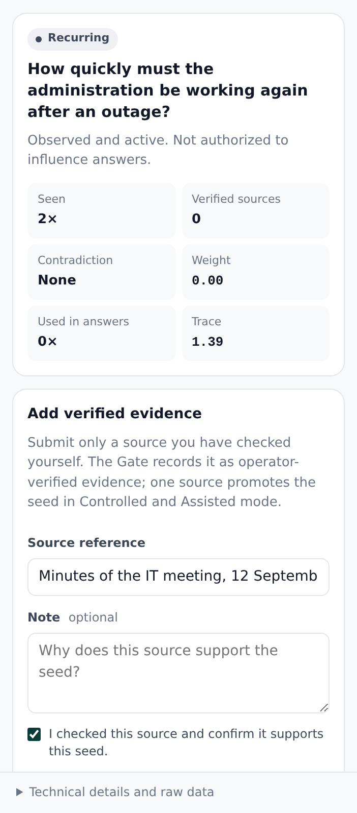{.narrow}

*Recording a source for a recurring seed.*

The Gate assesses the source at once. In the default mode one verified source
is enough: the seed becomes **Promoted** with weight 0.20.

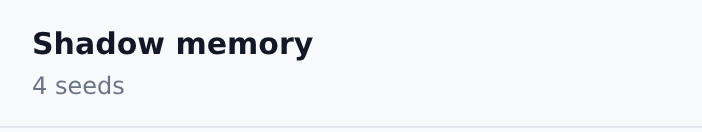{.narrow}

*The same seed after one verified source.*

> **Caution.** By ticking the box you declare that you read the source
> yourself. Shadowseed records that declaration in the audit ledger.
> Shadowseed does not check whether the source is right; that remains your
> responsibility.

Four rules keep the Gate reliable:

- **Only tick what you have read.**
- **One source counts once.** Entering the same reference again adds no
  weight.
- **A model answer is not a source.** Refer to the original document, not to
  what the model said about it.
- **Recurrence is not a source.** A seed that keeps coming back still needs a
  source.

## 9. When a seed takes part

A promoted seed takes part only when it fits the question you ask. In the
example the school next asks how often the backup should run. The seed about
recovery time fits that question, and the answer takes it into account:

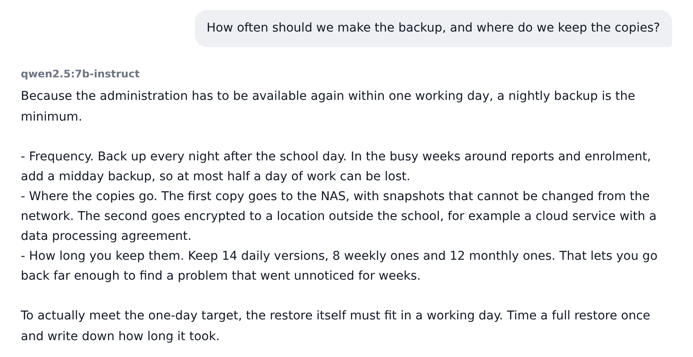

*The answer uses the recorded decision: recovery within one working day.*

The seed's status becomes **Used**, and the card shows how often it was used:

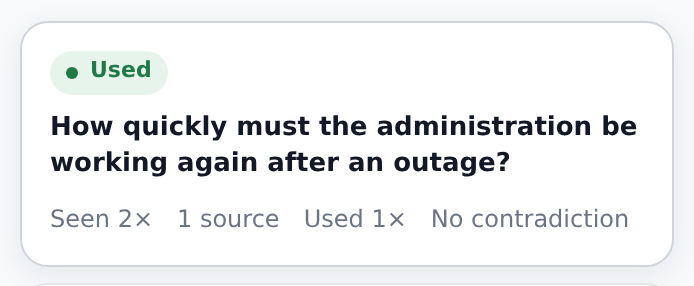{.narrow}

*After use the seed shows as Used.*

Shadowseed lets a seed take part only when, at the moment of your question,
all of the following hold:

1. the seed is promoted and has weight;
2. that promotion rests on a valid Gate decision;
3. no contradiction is open;
4. the seed fits your current question;
5. the last check just before the answer (*point of use*) allows it.

So *Promoted* does not mean *always used*. If you ask the example conversation
about passwords, the seed about recovery time stays silent. That is intended.

The seed reaches the model as background, explicitly marked as unverified
context. The model is not told that it is a fact. And when a seed has been used
in an answer, new seeds from that same answer are not stored. That way
Shadowseed does not learn from its own influence.

### The timeline

At the bottom of the seed is the **Timeline**. It lists every observation,
validation, Gate decision and use, newest first. Expand a line for the full
record.

{.narrow}

*The timeline of the used seed.*

### Technical details

Below the Shadow memory, **Technical details and raw data** opens the
conversation's data: the Gate policy, the authority profile, a fingerprint of
all settings (*behavior digest*) and the complete raw data of the conversation
and the last turn. **Copy** copies it, for example for a problem report.

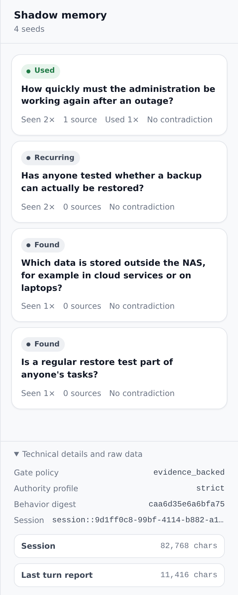{.narrow}

*Technical details of the example conversation.*

## 10. Contradicting a seed

Is a seed wrong, or out of date? Open it and click **Mark as contradicted**
under **Contradiction**. The seed becomes **Blocked** and can no longer
influence any answer, even if it was promoted.

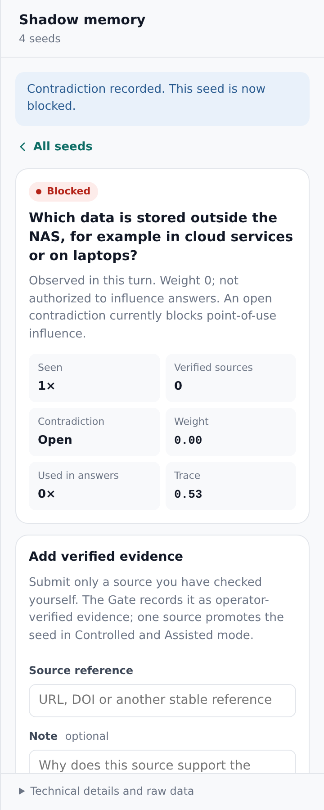{.narrow}

*A blocked seed.*

To lift the block, enter under **Basis for resolution** why the contradiction
no longer applies, and click **Resolve contradiction**. That removes only the
block. The seed does not get its weight back by itself: that needs a new
verified source.

## 11. Authority modes

The authority mode decides how a seed can gain influence. You choose it when
you start a conversation; after that it is fixed.

| Mode | How a seed gains influence | Use it for |
| --- | --- | --- |
| **Controlled** (default) | Only through a source you checked. One source is enough. | Everyday work |
| **Assisted** | As Controlled. In addition, Shadowseed points out seeds that keep coming back without a source (label *Action required*). | When you want a nudge |
| **Autonomous** | Recurrence counts as support; no source is needed. | Research only |

In Autonomous mode the system grants influence without you. Use it to study
the mechanism, not for answers you want to rely on.

## 12. On a phone-sized screen

Shadowseed also works in a narrow window. The side panels then fold away: the
menu at the top left opens your conversations, the **Shadow** button at the top
right opens the Shadow memory.

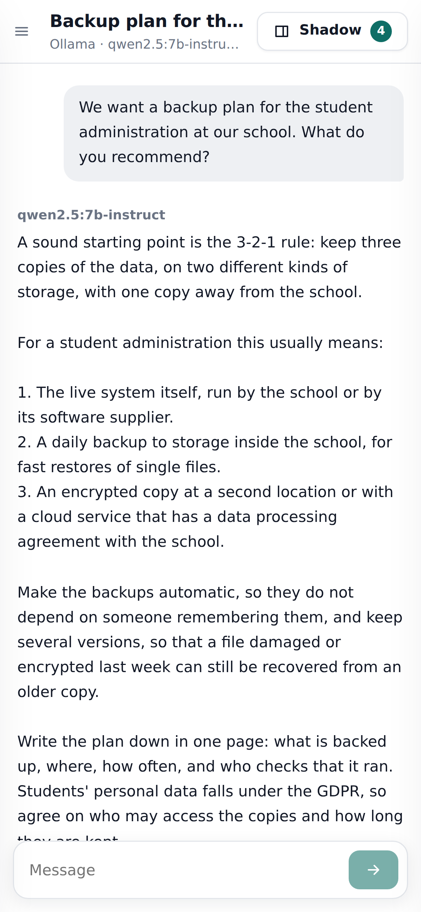{.small}

*The example conversation on a phone-sized screen.*

Shadowseed always runs on the computer where you started it. A phone cannot
reach it over the network, so this layout is for a narrow window on the same
computer.

## 13. Using OpenAI

The downloadable app works with local models only. If you install Shadowseed
as a Python package with the `openai` extra (chapter 21), you can also use
OpenAI models:

1. Open **Providers** at the bottom left and enter a **Temporary API key**. The
   key stays in memory only and disappears when Shadowseed stops.
2. When you create a conversation, choose *OpenAI (hosted)* and confirm that
   your questions, seeds and texts are sent to OpenAI.
3. You confirm this again with every message.

> **Caution.** With OpenAI your data leaves your computer. What OpenAI does
> with it is governed by your own agreement with OpenAI.

## 14. Data, backups and privacy

### What Shadowseed stores

Everything is in the `.shadowseed` folder in your home folder:

| System | Folder |
| --- | --- |
| Windows | `C:\Users\<name>\.shadowseed` |
| macOS | `/Users/<name>/.shadowseed` |
| Linux | `/home/<name>/.shadowseed` |

It holds your conversations, the answers, the seeds, the Gate decisions, your
source references and notes, and the audit ledger. Next to it is
`.shadowseed-integrity`, with the key that protects the ledger. Nothing leaves
your computer unless you use OpenAI.

> **Caution.** Do not put passwords, API keys or other secrets in
> conversations, source references or notes. Use made-up or anonymised data
> when real personal data is not needed.

### Making and restoring backups

The app has no backup button yet. You use the Python package from the same
release (chapter 21):

| Command | What it does |
| --- | --- |
| `shadowseed workspace info` | Shows where your data is and how much there is |
| `shadowseed workspace backup --output <file>` | Makes a complete, consistent copy |
| `shadowseed workspace restore <file>` | Restores a copy |
| `shadowseed workspace delete --yes` | Deletes everything in `.shadowseed` and `.shadowseed-integrity` |

> **Caution.** Always give `backup` a file outside `.shadowseed`. Without
> `--output` the backup goes to `.shadowseed/exports`, and that folder is
> deleted along with the workspace.

Do not copy or move the folders by hand. A backup holds the same data as the
original; keep it just as carefully.

### Exporting a conversation

| Command | Contents |
| --- | --- |
| `shadowseed export-workbench-report <session>` | The whole conversation, with checksums. Contains all text |
| `shadowseed export-support-bundle <session>` | Structure and counts only, without conversation or seed text. Meant for problem reports |

The session id is under **Technical details and raw data**, next to
**Session**.

## 15. Troubleshooting

| What you see | Likely cause | Solution |
| --- | --- | --- |
| The browser does not open | No default browser, or blocked | Copy the address from the Shadowseed window |
| macOS: "cannot be opened" | Quarantine on a downloaded app | Right-click → Open, or the `xattr` command from chapter 4 |
| Windows: SmartScreen warning | App not signed by Microsoft | *More info* → *Run anyway* |
| "Ollama not reachable" | Ollama is not running | Start Ollama and try again |
| Message about `embeddinggemma` | Model missing or Ollama too old | `ollama pull embeddinggemma`; update Ollama |
| "Model not found" | Name differs from the installed name | Copy the name exactly from `ollama list` |
| An answer takes minutes | The model runs on the processor | Normal without a GPU; choose a smaller model |
| No seeds appear | Small models find little | Continue the conversation, or choose a larger model |
| Label *Provider needed* | This conversation's model is unreachable | Start Ollama, or set up OpenAI |

### Shadowseed doctor

The Python package includes a diagnostic program. It checks the workspace, the
database, the audit ledger, permissions, disk space and Ollama, and tells you
how to fix what it finds:

```text
$ shadowseed doctor
python                   OK    3.11.15
workspace                OK    /home/you/.shadowseed
production_integrity     OK    verified ledger head sequence 7
ollama                   WARN  not detected at http://127.0.0.1:11434
                               Start `ollama serve`, pull a model, and rerun `shadowseed doctor`.
Workbench can start.
```

The doctor is not part of the downloadable app. Install the Python package
from the same release (chapter 21); it checks the same `.shadowseed` folder.

## 16. Limitations

- **Few seeds with small models.** With a 7B model a seed appears in about one
  turn in eight, and about a quarter of those are useful.
- **Slow without a GPU.** Two to three minutes per answer with a 7B model.
- **No evidence of better answers.** Whether SSL improves answers is still
  being studied.
- **Seeds can be wrong.** A promoted seed is supported by the source you chose,
  not proven.
- **One user, one computer.** Shadowseed is not a multi-user or network
  service.
- **Not signed by Apple or Microsoft.** Your system warns at first start.
- **English interface only** for now.
- **No compare button.** Setting an answer next to the same answer without SSL
  is possible only through the web API (chapter 19).
- **No backup button.** Backups are made with the Python package.

---

# Part 4 — Testing

For anyone who tries out a version and reports findings.

## 17. A test session

### What to look at

- Can you download, start and use the app without other software?
- Is it always clear which model and which authority mode are active?
- Does it feel like an ordinary chat, even if you ignore the seeds?
- Do you understand the statuses and the explanation of a seed?
- Is it clear that you must check a source, and that recurrence is not
  evidence?
- Do the error messages help when Ollama or a model is missing?
- Can you close a conversation and reopen it later without losing anything?

### How to test

1. Start with the offline demo. It shows the controls, not the quality.
2. Then switch to Ollama with a real model and hold conversations of eight
   turns or more. Seeds and recurrence need time.
3. For each session, note the model, the authority mode and what you did.

### Reporting a problem

A good report contains:

- what you were trying to do;
- the model and the authority mode;
- the shortest series of steps that brings the problem back;
- what you expected and what happened;
- whether a seed was used in that turn.

Leave out personal data and secrets. Attach a support bundle rather than a
full report (chapter 14).

> **Important.** If anyone can change a seed's weight or status without going
> through the Gate, that is a serious defect. Report it with priority.

### Collecting support bundles

A support bundle holds structure and counts but no conversation or seed text.
Whoever coordinates a test with several testers combines bundles with
`scripts/aggregate_support_bundles.py`. Do not edit a bundle by hand: the
integrity check then fails.

---

# Part 5 — Research

The model behind Shadowseed, and how to study it fairly.

## 18. The SSL model

### Lifecycle

A seed passes through fixed steps. Each step is separate from the others, and
only the Gate changes authority.

| Step | What happens |
| --- | --- |
| **Detection** | The model reads the question, the draft answer and at most four earlier turns, and proposes zero to five open points (prompt `detector_current_pair` v0.6) |
| **Intake** | A proposal becomes a seed with weight 0 if it is one question, or one English statement that is not a bare list |
| **Recurrence** | The session model judges whether a new note is the same open question as an earlier one (ADR-012). Text similarity serves as a floor (0.3) and as the fallback |
| **Trace** | Records recent presence and decays with a half-life. Seeds become *Dormant* and later *Expired* |
| **Gate** | The only place where weight and status change |
| **Point of use** | The last check just before an answer |

### Gate policy

| Policy | Accepts |
| --- | --- |
| `evidence_backed` | Verified external support only. In Controlled and Assisted one source promotes (threshold 0.2, ADR-011) |
| `exploratory` | Enough recurrence, or verified external support |
| `legacy_evidence_required` | Historical thresholds, kept for comparability |

A source needs a non-empty `source_ref`. That reference is the identity of the
evidence: the same reference never counts twice, not even through another
route. A contradiction is a separate record with an id, reason, status and
basis for resolution. Resolving lifts the block but restores no weight.

### Point of use

Before a seed may influence an answer, `AgentSafetyContract.decide_and_record`
checks four things: positive weight, status *promoted*, no blocking
contradiction, and a valid Gate decision for the seed's current authority
version. Both permission and refusal are recorded, and every permission refers
to the Gate decision it rests on. That makes it possible to see afterwards
whether an outdated permission was used.

### Two kinds of memory

Under `evidence_backed`, recurrence is only a trace: an observation you can
study. Under `exploratory`, recurrence can count as support after three
occurrences. The product uses `evidence_backed` by default.

## 19. Showing that SSL had an effect

Two answers always differ a little, even without SSL. A different answer is
therefore no proof that a seed had influence. Attribute an effect to SSL only
when:

1. the seed was promoted;
2. it was selected as relevant for that turn;
3. the point-of-use check allowed it;
4. it was actually injected, as recorded in the turn report and the timeline.

For a fair comparison, send a turn through the web API (chapter 24) with
`compare_without_ssl: true`. Shadowseed then produces a second answer with the
same model, the same visible history and the same question, but without seeds.
The comparison changes nothing in the stored state. You find it under
**Technical details and raw data** → **Last turn comparison**.

## 20. Studies and evidence

The repository contains pre-registered studies and their results:

| Study | Question | Status |
| --- | --- | --- |
| Seed calibration (`docs/research/seed-calibration.md`) | How useful are the seeds found, and how reliable is recurrence recognition? | Completed |
| Detector calibration (`docs/research/detector-calibration.md`) | Does a different detector prompt improve Qwen 2.5 7B's seeds? | Completed: more seeds, not better ones |
| Evidence efficacy (`docs/research/evidence-efficacy.md`) | Does an authorised seed improve answers, compared with SSL off and with self-critique? | Pilot |

Four principles apply to every study:

- record the design and the decision rule before measuring;
- review blind, and record the ratings before opening the key;
- record the exact model version, the source commit and the prompt versions;
- treat what the model says as observation, never as evidence.

Research tools are in the `research/` package and in `scripts/`. Results are
stored with their provenance under `benchmarks/`.

---

# Part 6 — Development

Working with the source code, the structure of the system and its interfaces.

## 21. Working from source

### Installing

From a release, without Git:

```bash
python -m pip install shadowseed-0.12.4-py3-none-any.whl
```

From the repository:

```bash
git clone https://github.com/E-AI-MODEL/shadowseed-pro.git
cd shadowseed-pro
python -m pip install -e ".[test]"
```

Python 3.10 or later is required. Optional extras:

| Extra | Adds |
| --- | --- |
| `openai` | OpenAI models and embeddings |
| `models` | Hugging Face and Sentence Transformers |
| `workbench` | The legacy Gradio interface |
| `vector`, `build`, `standalone-build`, `security` | Vector storage, builds and security checks |
| `dev` | All of the above |

### Tests and checks

```bash
python -m pytest -q            # full test suite
ruff check src tests scripts   # style and errors
uv lock --check                # lockfile matches pyproject.toml
```

The web client is a Next.js app in `apps/web`. Build it and copy the output
into the Python package with `scripts/sync_web_assets.py`.

### Rules for changes

- The Validation Gate is the only route to authority. Do not add a second one.
- The fields `weight`, `status`, `evidence_count` and `contradiction_score`
  cannot be assigned directly; tests guard this.
- A change to the authority model needs an ADR in `docs/architecture/adr/`.
- Every change goes through a pull request with green CI.

## 22. Architecture

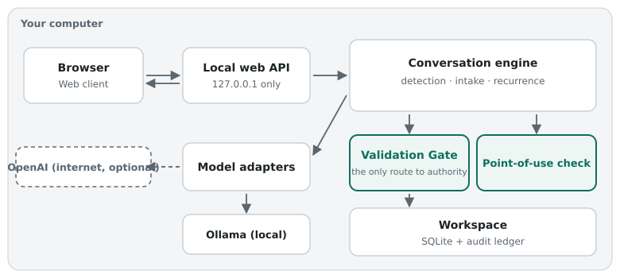

*The parts of Shadowseed. Everything runs on your own computer; OpenAI is
optional.*

| Part | Location | Role |
| --- | --- | --- |
| Conversation engine | `src/shadowseed/` (`chat.py`, `manager.py`, `lifecycle.py`) | Conversation, seeds and lifecycle |
| Detection | `src/shadowseed/detection/` | Detector prompts and parsing |
| Intake and recurrence | `intake.py`, `recurrence_*.py` | Which proposals become seeds, and when a seed recurs |
| Gate | `src/shadowseed/gate/` | The Validation Gate and its ledger |
| Storage | `src/shadowseed/storage/` | SQLite workspace and integrity ledger |
| Application | `src/shadowseed/application/` | Workspace, limits, health checks |
| Adapters | `src/shadowseed/adapters/` | Ollama, OpenAI, Hugging Face, embeddings |
| Web API | `src/shadowseed_webapi/` | Loopback HTTP server and launcher |
| Web client | `apps/web/` | The browser interface |
| Legacy Workbench | `src/shadowseed/workbench/` | Gradio interface, on request only |
| Research | `research/` | Benchmarks and studies |

Design decisions are in `docs/architecture/adr/` (ADR-001 to ADR-012). Start
with ADR-001 (the Gate as the sole source of authority), ADR-006 (the
boundary of the local production profile), ADR-011 (one-source promotion) and
ADR-012 (model-recognised recurrence).

## 23. Command line

| Command | Purpose |
| --- | --- |
| `shadowseed-web [--port N] [--workspace DIR] [--no-browser]` | Start the app (default port 8765, loopback only) |
| `shadowseed-web --self-test --workspace DIR` | Run the built-in self-test |
| `shadowseed chat --backend fixture\|ollama\|openai` | Chat in the terminal |
| `shadowseed doctor [--json] [--workspace DIR]` | Check the installation |
| `shadowseed init [--workspace DIR]` | Create a workspace |
| `shadowseed workspace info\|backup\|restore\|delete` | Manage the workspace |
| `shadowseed-workbench [--legacy-gradio]` | Start the desktop launcher; `--legacy-gradio` opens the old interface |
| `shadowseed export-workbench-report <session>` | Export a conversation as a full report |
| `shadowseed export-support-bundle <session>` | Export a support bundle without text |

Every command shows all its options with `--help`. `docs/usage/cli.md`
describes the research and benchmark commands.

## 24. Web API

The server listens on `127.0.0.1` only. All routes start with `/api/v1`.

| Method | Route | Purpose |
| --- | --- | --- |
| GET | `/health` | Health check |
| GET | `/providers` | Status of the model providers |
| POST | `/providers/openai/credential` | Set a temporary OpenAI key |
| POST | `/providers/openai/credential/clear` | Clear that key |
| GET | `/sessions` | List conversations |
| POST | `/sessions` | Create a conversation (`title`, `backend`, `model_id`, `authority_mode`, `external_confirmed`) |
| GET | `/sessions/{id}` | Read a conversation |
| POST | `/sessions/{id}/turns` | Send a message (`question`, `request_id`, optional `compare_without_ssl`, `external_confirmed`) |
| GET | `/sessions/{id}/seeds/{seed}` | Read a seed with its timeline |
| POST | `/sessions/{id}/seeds/{seed}/evidence` | Record a source (`source_ref`, `note`, `operator_verified: true`, `request_id`) |
| POST | `/sessions/{id}/seeds/{seed}/contradictions` | Record a contradiction (`request_id`) |
| POST | `/sessions/{id}/seeds/{seed}/contradictions/resolve` | Resolve a contradiction (basis required, `request_id`) |

**Safe retries.** A turn and the three seed actions take a `request_id`.
Sending the same id again is safe: the action happens once. An id reused with
different content is refused. Creating a conversation and setting or clearing
the OpenAI key take no `request_id`; repeating them repeats the action.

**Isolation.** Requests from another website, or with a `Host` header that does
not point to loopback, are refused.

## 25. Builds and releases

| Step | What happens |
| --- | --- |
| **CI** on every pull request | Tests on Python 3.10 and 3.12, local production checks on Windows, macOS and Linux, a strict audit of the shipped dependencies, and frozen builds for the three platforms |
| **Release Workbench** (manual) | Publishes the version in `pyproject.toml` from the exact commit on `main`, after CI on that commit is green. Builds the three downloads, `SHA256SUMS`, `PROVENANCE.json`, an SBOM, the wheel and the sdist |
| **Production Release Assurance** (automatic) | Checks the attestations, checksums and provenance of the published tag |

A version is called *production-ready/local* only when a real use cycle with
Ollama and `shadowseed doctor` on the published version has also been
recorded, with no open serious findings (P0/P1). Release notes are in
`docs/workbench/release-<version>.md`.

---

# Part 7 — Security and operations

What the local profile does and does not protect, and how to run Shadowseed
reliably.

## 26. Security model

| Shadowseed claims | Shadowseed does not claim |
| --- | --- |
| The server is reachable only through `127.0.0.1`, and the `Host` header is checked against DNS rebinding | Protection against a compromised operating system or administrator |
| Actions that change authority are attributed to a trusted local user | Separation between users, or safety on a hostile network |
| A client flag alone never grants authority | That a source the user marks as checked is correct |
| The Gate and the point-of-use check are the only route to influence | General protection against prompt injection |
| Tampering with the history, or rolling back to an older state, is detectable | Better answers in general |
| Operational logs contain as little content as possible | Secure deletion beyond what the file system provides |
| Releases are tied to an exact commit through checksums and provenance | |

The full threat model is in `docs/architecture/production-threat-model.md`.

## 27. Running reliably

- **Limits.** Oversized input is refused before anything is stored. A model
  call stops after 120 seconds and is not retried automatically. A failed turn
  does not change the stored state.
- **Permissions.** On macOS and Linux only the owner can read the workspace. On
  Windows the user account protects it.
- **Integrity.** The audit ledger records every authority event, protected by
  the key in `.shadowseed-integrity`. Never repair a workspace by deleting that
  folder; restore a verified backup instead.
- **Backups.** Use `shadowseed workspace backup --output <file>` with a file
  outside the workspace (chapter 14).
- **Containers.** `Dockerfile.workbench` is meant for development. Publish the
  port on loopback only: `-p 127.0.0.1:7860:7860`.
- **Diagnosis.** `shadowseed doctor` tells a usable state apart from integrity
  problems and missing parts.

Operating procedures: `docs/operations/production-local-recovery.md` and
`docs/operations/production-local-release.md`.

## 28. Settings

| Setting | Default | Meaning |
| --- | --- | --- |
| `--port` | 8765 | Preferred port; if it is taken, Shadowseed picks another |
| `--workspace` | `~/.shadowseed` | The data folder |
| `OLLAMA_HOST` | `http://localhost:11434` | Address of Ollama |
| `OPENAI_API_KEY` | not set | OpenAI key for the Python package; the app uses the temporary key |
| Authority mode | Controlled | Chosen per conversation |
| Embedding model | `embeddinggemma` | Needed for conversations with Ollama |

---

# Appendices

## A. Glossary

| Term | Meaning |
| --- | --- |
| Seed | A note about a possibly open point in the conversation |
| Shadow memory | All seeds of a conversation with their history |
| Validation Gate | The only place where a seed gains or loses influence |
| Authority mode | Controlled, Assisted or Autonomous |
| Authority | A seed's right to influence answers |
| Weight | How much authority the Gate granted, from 0 to 1 |
| Trace | How recently a seed was present |
| Recurrence | An open point that comes back in a later turn |
| Verified evidence | A source the user has read |
| Contradiction | A recorded objection that blocks a seed |
| Point of use | The last check just before an answer |
| Gate policy | `evidence_backed` or `exploratory` |
| Workspace | The `.shadowseed` data folder |
| Audit ledger | The protected record of all authority events |
| Offline demo | Working without a model, to explore the controls |

## B. Frequently asked questions

**Does Shadowseed send my conversations anywhere?**
No, unless you choose OpenAI. With Ollama everything stays on your computer.

**Why do I see so few seeds?**
Small models find few open points. Longer conversations and larger models
help.

**I added a source, but the seed is not used. Why?**
A promoted seed takes part only when it fits your question. Ask a question
about the seed's topic.

**Can I set a seed's weight myself?**
No. Only the Gate changes authority. That is a deliberate safeguard.

**Is a seed that keeps coming back promoted automatically?**
Not in Controlled and Assisted. There a verified source is always needed. Only
in Autonomous does recurrence count.

**Is a promoted seed true?**
Not necessarily. It is supported by the source you checked.

**May I use Shadowseed in my company?**
The licence is PolyForm Noncommercial 1.0.0. Commercial use needs separate
permission.

## C. About this document

| | |
| --- | --- |
| Applies to | Shadowseed 0.12.4 |
| Editions | English and Dutch, as Markdown and as PDF in `docs/manual/` |
| Screenshots | Shadowseed 0.12.4 with a pre-written example conversation (see chapter 2) |
| Licence | PolyForm Noncommercial License 1.0.0 |

Found an error or have a suggestion? Report it as an issue in the repository.
